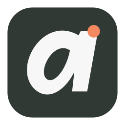
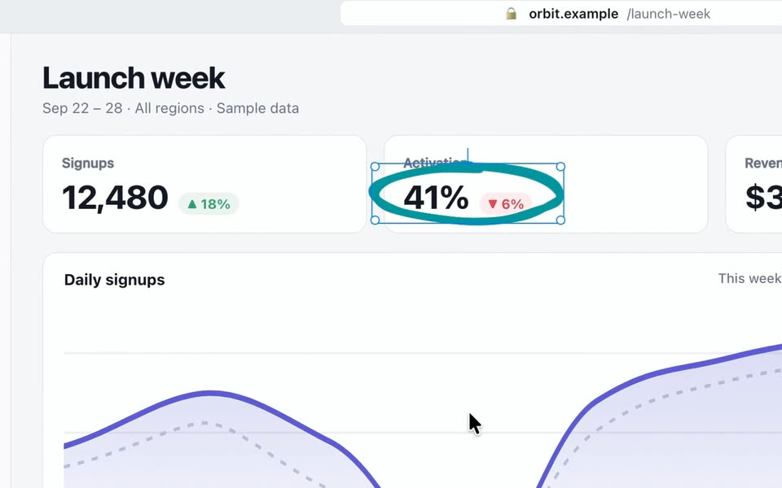
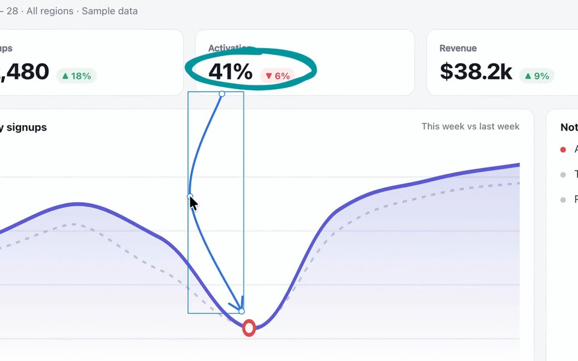
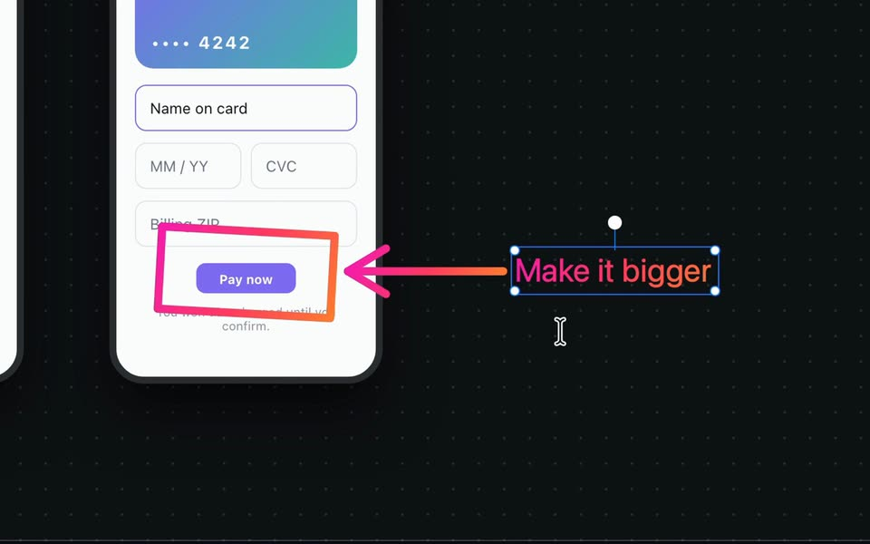
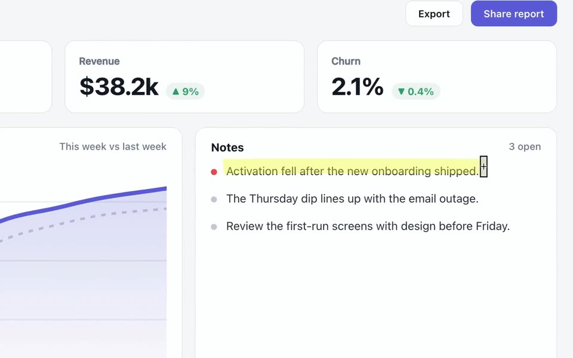
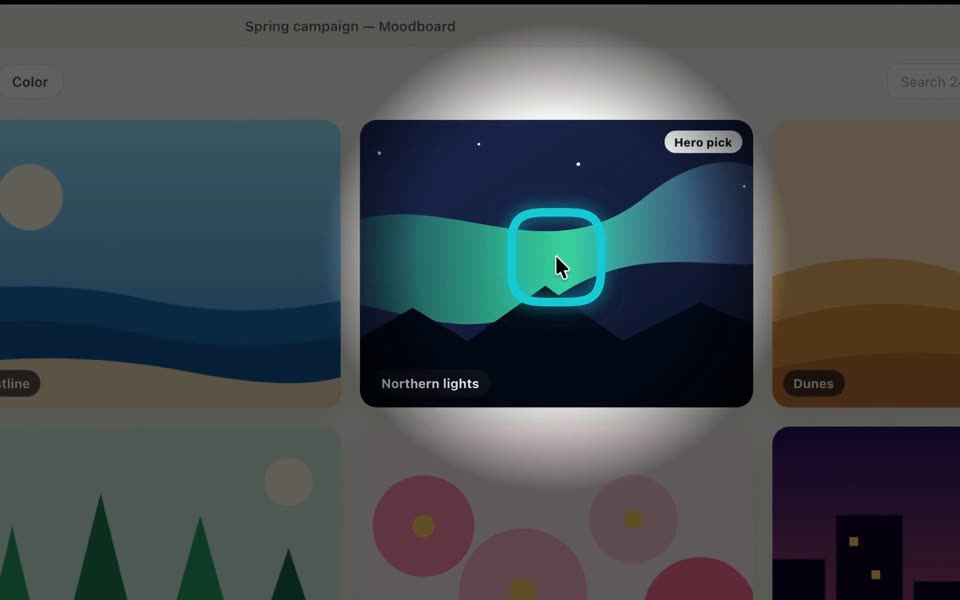
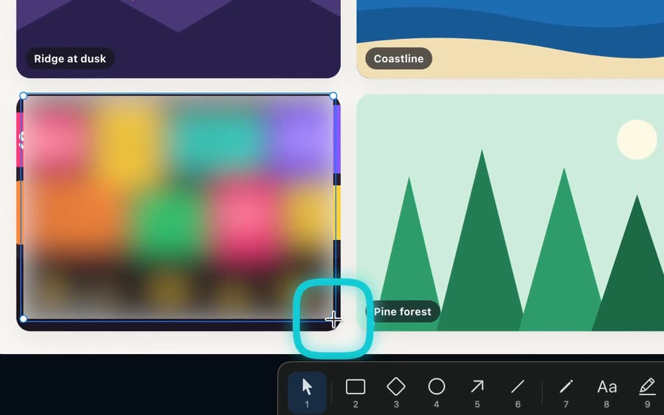

<div align="center">



# Annotator

**Draw on your screen as you explain.**<br>
Use it in demos, reviews and lessons. Every mark stays editable.
Native apps for macOS and Windows.

[**Download**](https://getannotator.app/downloads/) &nbsp;·&nbsp;
[Website](https://getannotator.app/) &nbsp;·&nbsp;
[Help](https://getannotator.app/docs/) &nbsp;·&nbsp;
[Release notes](https://github.com/dorlugasigal/annotator/releases)

[](https://github.com/dorlugasigal/annotator/releases)
[](#install)
[](#install)
[](LICENSE)<br>
[](https://github.com/dorlugasigal/annotator/actions/workflows/validate.yml)
[](https://scorecard.dev/viewer/?uri=github.com/dorlugasigal/annotator)
[](https://github.com/dorlugasigal/annotator/discussions)

</div>

https://github.com/user-attachments/assets/b87f25bf-7f11-4e36-8000-47584de43221

<p align="center"><sub>Recorded in the real Mac app, with a scripted pointer and made-up sample apps.<br>
Music: “Product Launch Advertising Commercial Music” by lNPLUSMUSIC, from Pixabay.</sub></p>

> [!NOTE]
> Annotator is in public beta. Expect rough edges, and please
> [report them](https://github.com/dorlugasigal/annotator/issues/new/choose).

## What you can do

Pick a tool in the floating toolbar and draw over any app. Your marks stay on
screen while you keep working in the app underneath, and you can move, restyle
or undo them later.

<table>
<tr>
<td width="50%" valign="top">
<br>
<b>Circle</b><br>
Choose Ellipse and circle a number. The Sketchy style keeps it hand-drawn.
</td>
<td width="50%" valign="top">
<br>
<b>Arrow</b><br>
Click to place points and press Return. Drag a point to bend the arrow.
</td>
</tr>
<tr>
<td valign="top">
<br>
<b>Smart Draw</b><br>
Sketch a box or an arrow, and Smart Draw makes it neat. Then type a label.
</td>
<td valign="top">
<br>
<b>Highlight</b><br>
Drag the highlighter across a line of text.
</td>
</tr>
<tr>
<td valign="top">
<br>
<b>Spotlight</b><br>
Turn on the cursor halo and Spotlight. The light follows your pointer.
</td>
<td valign="top">
<br>
<b>Blur</b><br>
Drag over a busy picture to blur it. Blur isn't secure redaction.
</td>
</tr>
</table>

There are more than 40 tools: shapes, diagram icons, screen zoom, a pointer
lens, Pixelate, numbered counters, a pixel ruler, pasted images and your own
saved shapes. Share part of a display in its own window, or start a break
timer before you leave the room. An AI app with computer-use tools can drive
Annotator through its normal interface ([AI control](docs/ai-control.md)).

## Install

### Mac

macOS 14 or later, on Apple Silicon or Intel.

- **Homebrew**: `brew install --cask dorlugasigal/annotator/annotator`
- **Disk image**: [download it](https://getannotator.app/downloads/), drag
  Annotator into Applications and open it. It runs from the menu bar.

Annotator updates itself from the Applications folder. With Homebrew, run
`brew upgrade --cask dorlugasigal/annotator/annotator`.

### Windows

Windows 11, version 22H2 or later, on x64 or ARM64.

- **Microsoft Store**: [Annotator – Screen Annotation](https://apps.microsoft.com/detail/9NMZ345ZJ6JK),
  or `winget install --id 9NMZ345ZJ6JK --source msstore`. The Store keeps it
  up to date.
- **winget, without the Store**: `winget install DorLugasiGal.Annotator`, once
  the package is accepted into winget's catalog.
- **ZIP**: download `Annotator-<version>-windows-x64.zip` or `-arm64.zip`
  from the [latest release](https://github.com/dorlugasigal/annotator/releases).
  The ZIPs aren't code-signed yet, so Windows may show a SmartScreen warning.

Annotator runs from the system tray, near the clock.

## Get started

| To | Mac | Windows |
| --- | --- | --- |
| Draw on the screen | <kbd>⌃⇧2</kbd> | <kbd>Ctrl+Shift+2</kbd> |
| Use the app underneath, drawings still on screen | <kbd>Esc</kbd> | <kbd>Esc</kbd> |
| Show or hide drawings and the toolbar | <kbd>⌃2</kbd> | <kbd>Ctrl+2</kbd> |
| Zoom around the pointer | <kbd>⌃1</kbd> | <kbd>Ctrl+1</kbd> |
| Open the tool library while drawing | <kbd>⌘L</kbd> | <kbd>Ctrl+L</kbd> |

Change the keys in Settings > Toolbar & Shortcuts.

## Privacy and screen sharing

- There is no account. Your drawings, screen pixels and keystrokes stay on your computer.
- Drawing needs no permissions. Screen zoom and live effects read the screen while they run; Annotator doesn't record or save video.
- Usage counts are off unless you turn them on. Even then, they never include drawings, screenshots or text.
- If you share your whole screen, others see your drawings. App or window sharing may leave them out, so ask someone on the call what they see.
- Blur, Pixelate and Distort can leave details readable. Hiding or quitting Annotator removes covers.

[Privacy](https://getannotator.app/privacy/) ·
[Screen-sharing limits](docs/compatibility.md)

## Build from source

Both apps live in this repository. The Mac app is the behavioral reference; the
Windows app matches it ([parity](docs/parity.md)).

**Mac** (Xcode 26.6, XcodeGen; see `tools/macos/toolchain.json`):

```sh
brew bundle                       # installs XcodeGen
export DEVELOPER_DIR=/Applications/Xcode.app/Contents/Developer
make test                         # Swift package tests
make app                          # unsigned development app
open "build/UnsignedDerivedData/Build/Products/Debug/Annotator Dev.app"
```

**Windows** (.NET 10 SDK, Visual Studio with C++ tools and Windows SDK 10.0.26100;
see `tools/windows/toolchain.json`):

```powershell
pwsh -NoProfile -File tools/windows/validate.ps1 core
pwsh -NoProfile -File tools/windows/validate.ps1 all
```

**Website** (Node 26.8.1, as in CI):

```sh
npm --prefix website ci && npm --prefix website run build && npm --prefix website test
```

Development builds are named **Annotator Dev** and never replace a release.

### Where things are

| Path | What's there |
| --- | --- |
| [`apps/macos`](apps/macos) | The Mac app in Swift, its `AnnotationCore` library and tests |
| [`apps/windows`](apps/windows) | The Windows app in C# (.NET 10, WinUI 3, Native AOT), its libraries and tests |
| [`reference`](reference) | The conformance corpus and UX reference the Mac generates, so Windows can match it |
| [`website`](website) | getannotator.app |
| [`services/metrics`](services/metrics) | The opt-in usage counts service |
| [`tools`](tools/README.md) | Build, CI, release and demo scripts |
| [`docs`](docs/README.md) | Architecture, parity, releasing and maintainer guides |
| [`releases`](releases) | Release notes and release settings |

Start with [docs/architecture.md](docs/architecture.md).

## Contributing

Bug reports, feature ideas and pull requests are welcome. Read
[CONTRIBUTING.md](CONTRIBUTING.md) first: every user-visible change ships on
both Mac and Windows, and every pull request names its issue.

- To start small, pick a [good first issue](https://github.com/dorlugasigal/annotator/labels/good%20first%20issue)
  or one marked [help wanted](https://github.com/dorlugasigal/annotator/labels/help%20wanted).
- Questions and ideas go to [Discussions](https://github.com/dorlugasigal/annotator/discussions).
- Report security problems privately ([SECURITY.md](SECURITY.md)).
- For help with the app, see [SUPPORT.md](SUPPORT.md).

If Annotator helps you, you can [buy me a coffee](https://buymeacoffee.com/dorlugasigal).
All tools stay free either way.

## License

Annotator is open source under the [Apache License 2.0](LICENSE).
Third-party components keep their own licenses ([notices](THIRD_PARTY_NOTICES.md)).
The name and icon are covered by [TRADEMARK.md](TRADEMARK.md).
