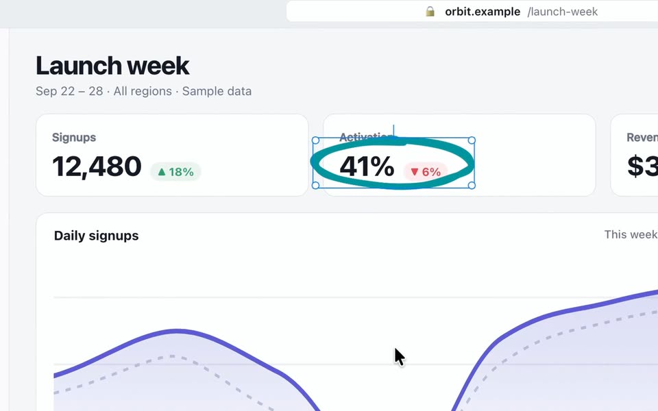
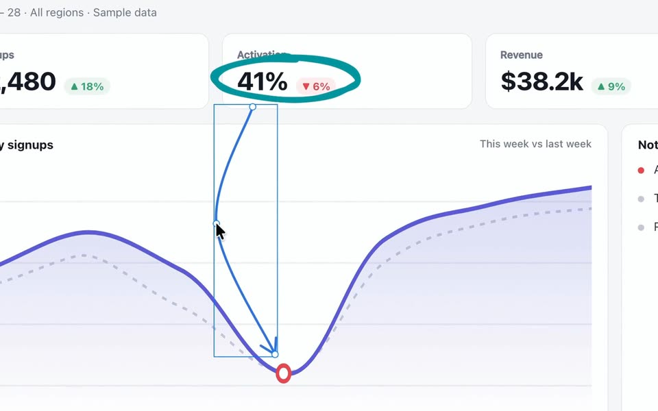
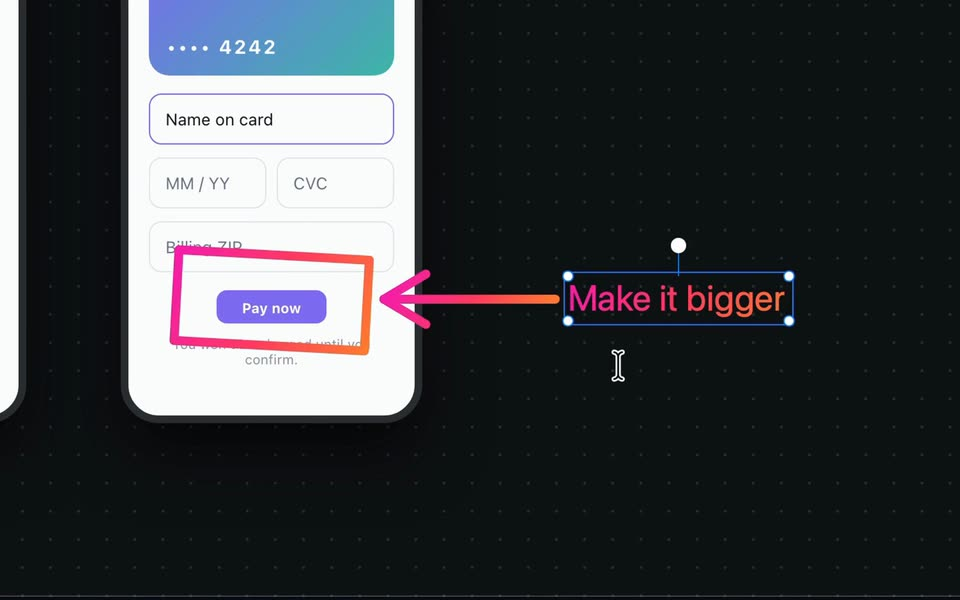
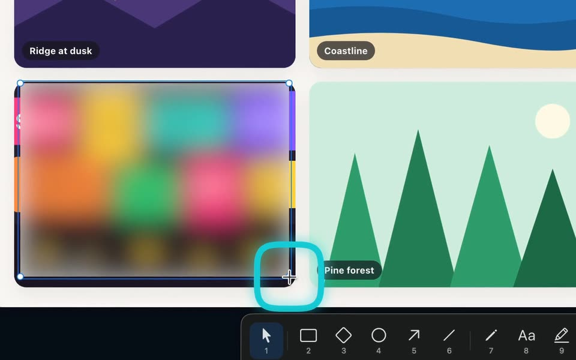
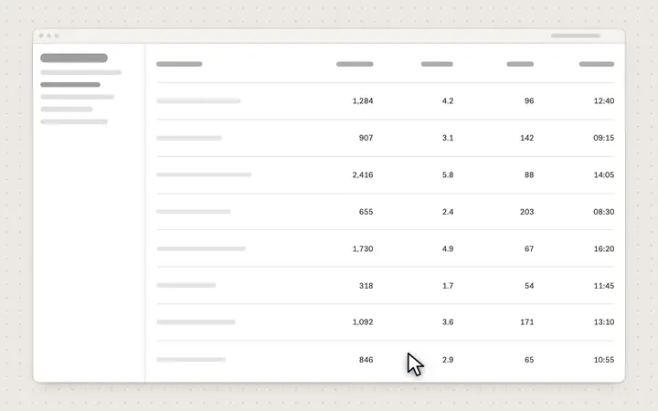
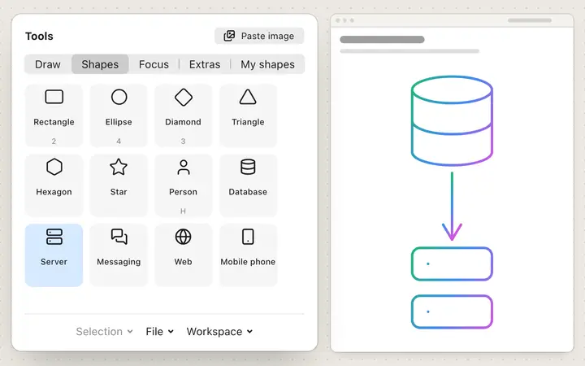
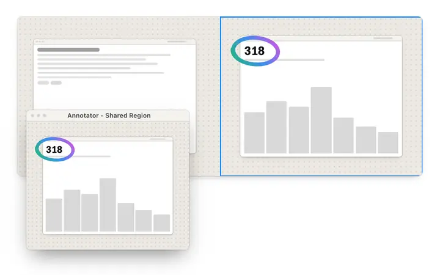
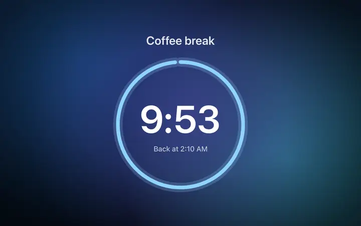
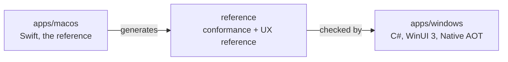

<div align="center">

<a href="https://getannotator.app/">
  <picture>
    <source media="(prefers-color-scheme: dark)" srcset=".github/readme/banner-dark.gif">
    
  </picture>
</a>

Draw right on top of whatever you're sharing, so people know where to look.
Annotator is free, open source and native on macOS and Windows, and every mark
stays editable.

[**Download**](https://getannotator.app/downloads/) &nbsp;·&nbsp;
[**Try it in your browser**](https://getannotator.app/#try) &nbsp;·&nbsp;
[Help](https://getannotator.app/docs/) &nbsp;·&nbsp;
[Release notes](https://github.com/dorlugasigal/annotator/releases)

[](https://github.com/dorlugasigal/annotator/releases/latest)
[](#install)
[](#install)
[](LICENSE)
[](https://github.com/dorlugasigal/annotator/actions/workflows/validate.yml)
[](https://scorecard.dev/viewer/?uri=github.com/dorlugasigal/annotator)

<a href="https://buymeacoffee.com/dorlugasigal"></a>

</div>

> [!NOTE]
> Heads up, Annotator isn't at 1.0 yet, so you'll hit a rough edge here and
> there. When you do, [tell me about it](https://github.com/dorlugasigal/annotator/issues/new/choose)
> and I'll take a look.

## Keys

You only need the first three to get going. The other two are there when you
want them.

| | Mac | Windows |
| --- | :---: | :---: |
| **Draw** on the screen | <kbd>⌃⇧2</kbd> | <kbd>Ctrl+Shift+2</kbd> |
| **Use apps** again, drawings stay put | <kbd>Esc</kbd> | <kbd>Esc</kbd> |
| **Hide or show** drawings and the toolbar | <kbd>⌃2</kbd> | <kbd>Ctrl+2</kbd> |
| Zoom in around the pointer | <kbd>⌃1</kbd> | <kbd>Ctrl+1</kbd> |
| Open the tool library while drawing | <kbd>⌘L</kbd> | <kbd>Ctrl+L</kbd> |

Don't like them? Change any key in Settings > Toolbar & Shortcuts.

## What you can do

Pick a tool and draw over whatever you're showing. The app underneath keeps
working, so you can click around between marks, and you can move, restyle or
undo any mark later.

<table>
<tr>
<td width="33%" valign="top">
<br>
<b>Circle it</b><br>
Ellipse, in a neat or sketchy style.
</td>
<td width="33%" valign="top">
<br>
<b>Point at it</b><br>
Click points, press Return. Drag a point to bend it.
</td>
<td width="33%" valign="top">
<br>
<b>Smart Draw</b><br>
Sketch a box or arrow and it comes out neat.
</td>
</tr>
<tr>
<td valign="top">
<br>
<b>Highlight</b><br>
Drag across a line of text.
</td>
<td valign="top">
<br>
<b>Spotlight</b><br>
The light follows your pointer.
</td>
<td valign="top">
<br>
<b>Blur</b><br>
Soften a busy picture. It isn't secure redaction.
</td>
</tr>
</table>

### And a few more

<table>
<tr>
<td width="50%" valign="top">
<picture>
  <source media="(prefers-color-scheme: dark)" srcset=".github/readme/zoom-dark.webp">
  
</picture><br>
<b>Zoom in</b> &nbsp;<kbd>⌃1</kbd> · <kbd>Ctrl+1</kbd><br>
Zoom in where your pointer is, so the small stuff is easy to read. A little map shows where you are.
</td>
<td width="50%" valign="top">
<picture>
  <source media="(prefers-color-scheme: dark)" srcset=".github/readme/shapes-dark.webp">
  
</picture><br>
<b>Shapes and icons</b> &nbsp;<kbd>⌘L</kbd> · <kbd>Ctrl+L</kbd><br>
Grab a database, a server or any other icon from the tool library, then join them up with an arrow.
</td>
</tr>
<tr>
<td width="50%" valign="top">
<picture>
  <source media="(prefers-color-scheme: dark)" srcset=".github/readme/share-dark.webp">
  
</picture><br>
<b>Share just one part</b><br>
Put one area of a wide screen in its own window, then share only that window. Handy on an ultrawide.
</td>
<td width="50%" valign="top">
<picture>
  <source media="(prefers-color-scheme: dark)" srcset=".github/readme/break-dark.webp">
  
</picture><br>
<b>Take a break</b> &nbsp;<kbd>⌃3</kbd> · <kbd>Ctrl+3</kbd><br>
A big countdown fills the screen, so everyone knows when to come back. Go get that coffee.
</td>
</tr>
</table>

There's also a pointer lens, Pixelate, numbered counters, a pixel ruler, pasted
images and shapes you save yourself, more than 40 tools in all.

If you use an AI app with computer-use tools, it can drive Annotator through the
normal app, the same way you would ([AI control](docs/ai-control.md)).

## Install

Pick your platform and you're a minute away from drawing.

| | Mac | Windows |
| --- | --- | --- |
| **Needs** | macOS 14 or later, Apple Silicon or Intel | Windows 11 22H2 or later, x64 or ARM64 |
| **Easiest** | `brew install --cask dorlugasigal/annotator/annotator` | [Microsoft Store](https://apps.microsoft.com/detail/9NMZ345ZJ6JK), or `winget install --id 9NMZ345ZJ6JK --source msstore` |
| **Or** | The [disk image](https://getannotator.app/downloads/): drag it into Applications | A ZIP from the [latest release](https://github.com/dorlugasigal/annotator/releases) (not code-signed yet, so SmartScreen may warn you) |
| **Lives in** | The menu bar | The system tray, near the clock |
| **Updates** | By itself, from Applications | Through the Store |

Installed with Homebrew? Update with `brew upgrade --cask dorlugasigal/annotator/annotator`.
On Windows, `winget install DorLugasiGal.Annotator` (without the Store) will work
as soon as winget accepts the package into its catalog.

## Privacy, in plain words

- There's no account. Your drawings, your screen and your keystrokes stay on your computer.
- Drawing needs no permissions. Zoom and live effects read the screen only while they run, and Annotator records nothing.
- Usage counts are off until you turn them on, and even then they never include drawings, screenshots or text.
- If you share your whole screen, people see your drawings. App or window sharing may leave them out, so ask someone on the call what they see.
- Blur, Pixelate and Distort can leave details readable, so don't count on them to hide secrets. Hiding or quitting Annotator removes them.

The details are in [Privacy](https://getannotator.app/privacy/) and
[screen-sharing limits](docs/compatibility.md).

## Build it yourself

Want to poke around the code? Both apps live in this repository. The Mac app is
the reference, and the Windows app is checked against it so the two behave the
same ([parity](docs/parity.md)).



<details open>
<summary><b>Mac</b> · Xcode 26.6 and XcodeGen (<code>tools/macos/toolchain.json</code>)</summary>

```sh
brew bundle                       # installs XcodeGen
export DEVELOPER_DIR=/Applications/Xcode.app/Contents/Developer
make test                         # Swift package tests
make app                          # unsigned development app
open "build/UnsignedDerivedData/Build/Products/Debug/Annotator Dev.app"
```
</details>

<details>
<summary><b>Windows</b> · .NET 10, Visual Studio C++ tools, Windows SDK 10.0.26100 (<code>tools/windows/toolchain.json</code>)</summary>

```powershell
pwsh -NoProfile -File tools/windows/validate.ps1 core
pwsh -NoProfile -File tools/windows/validate.ps1 all
```
</details>

<details>
<summary><b>Website</b> · Node 26.8.1, as in CI</summary>

```sh
npm --prefix website ci && npm --prefix website run build && npm --prefix website test
```
</details>

Your own builds are called **Annotator Dev**, so they never replace the real app.

Here's where things live:

| Path | What's there |
| --- | --- |
| [`apps/macos`](apps/macos) | The Mac app in Swift, its `AnnotationCore` library and tests |
| [`apps/windows`](apps/windows) | The Windows app in C# (.NET 10, WinUI 3, Native AOT), its libraries and tests |
| [`reference`](reference) | The conformance corpus and UX reference the Mac generates for Windows to match |
| [`website`](website) | getannotator.app and its in-browser demo |
| [`services/metrics`](services/metrics) | The opt-in usage counts service and its admin page |
| [`tools`](tools/README.md) | Build, CI, release and recording scripts |
| [`docs`](docs/README.md) | Architecture, parity, releasing and maintainer guides |
| [`releases`](releases) | Release notes and release settings |

New here? [docs/architecture.md](docs/architecture.md) is the best place to start.

## Come build it with me

I'd love your help. A bug report, a fix for a typo, an idea for a new tool or a
whole pull request, it all counts.

Have a look at [CONTRIBUTING.md](CONTRIBUTING.md) before your first pull
request. There's one big rule: every visible change ships on both Mac and
Windows. Only have one of them? That's fine. Say so in your pull request, and a
maintainer or another contributor will finish the other side before it ships.
Every pull request also links the issue it fixes.

- Looking for a first task? Try a [good first issue](https://github.com/dorlugasigal/annotator/labels/good%20first%20issue)
  or anything marked [help wanted](https://github.com/dorlugasigal/annotator/labels/help%20wanted).
- Got a question or a half-baked idea? Bring it to [Discussions](https://github.com/dorlugasigal/annotator/discussions).
- Found a security problem? Please report it privately ([SECURITY.md](SECURITY.md)).
- Stuck with the app itself? Start with [SUPPORT.md](SUPPORT.md).

## ☕ Buy me a coffee

Annotator is free, every tool, for everyone, and I'm keeping it that way. If it
saved you from saying "no, the other button" on a call, a coffee keeps me going
for the next release.

<p align="center">
  <a href="https://buymeacoffee.com/dorlugasigal"></a>
</p>

## License

Annotator is open source under the [Apache License 2.0](LICENSE). Third-party
parts keep their own licenses ([notices](THIRD_PARTY_NOTICES.md)), and the name
and icon are covered by [TRADEMARK.md](TRADEMARK.md).
