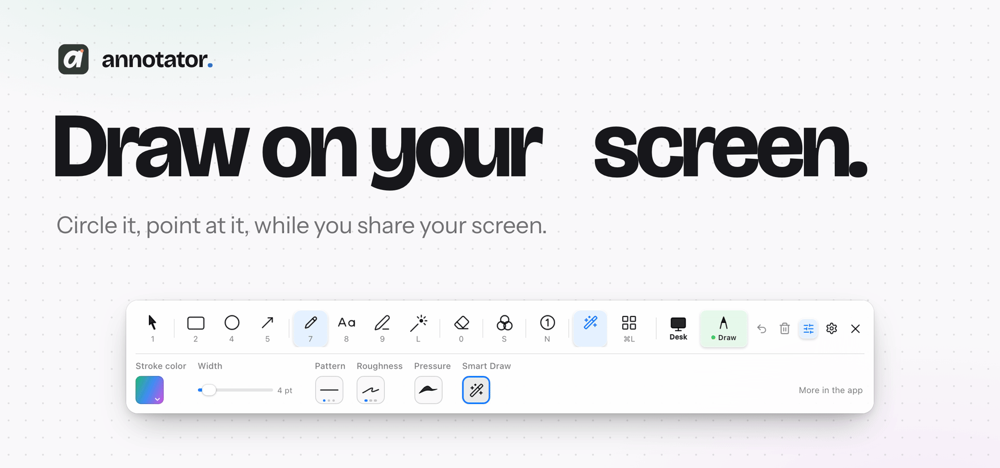
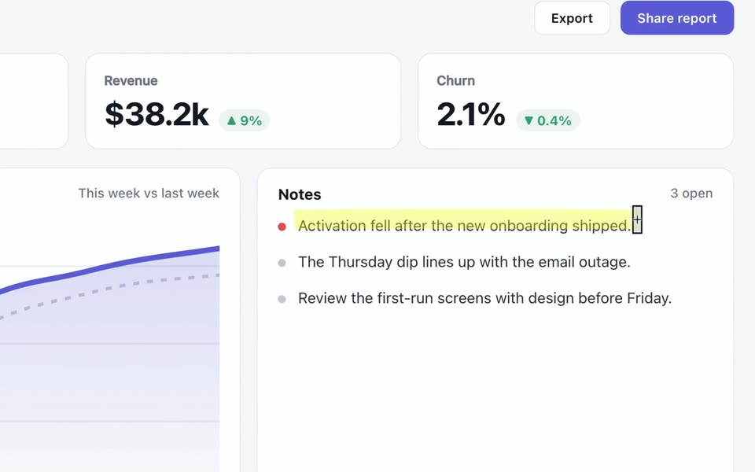
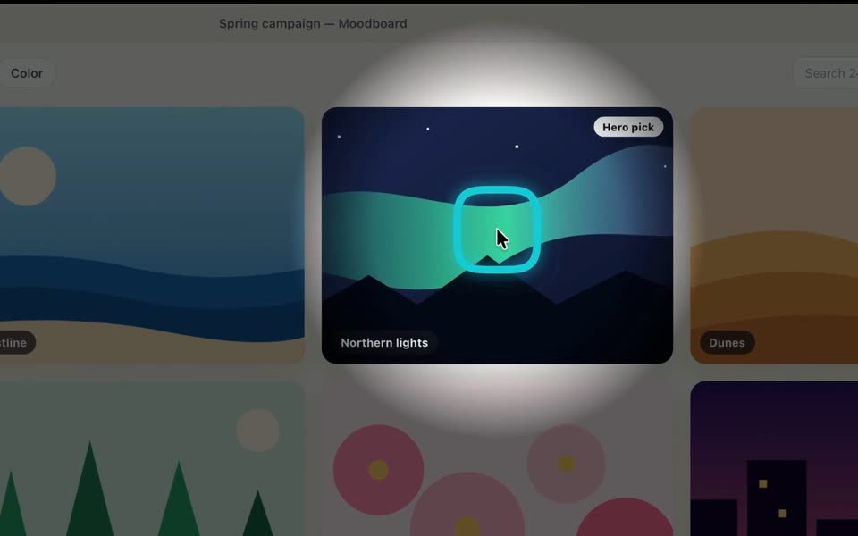
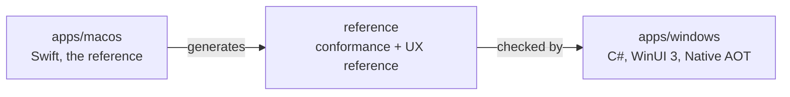

<div align="center">

<a href="https://getannotator.app/">
  <picture>
    <source media="(prefers-color-scheme: dark)" srcset=".github/readme/banner-dark.gif">
    
  </picture>
</a>

A free, open-source app for macOS and Windows that lets you draw right on top of
whatever you're showing. Every mark stays editable.

[**Download**](https://getannotator.app/downloads/) &nbsp;·&nbsp;
[**Try it in your browser**](https://getannotator.app/#try) &nbsp;·&nbsp;
[Help](https://getannotator.app/docs/) &nbsp;·&nbsp;
[Release notes](https://github.com/dorlugasigal/annotator/releases)

[](https://github.com/dorlugasigal/annotator/releases/latest)
[](#install)
[](#install)
[](LICENSE)
[](https://github.com/dorlugasigal/annotator/actions/workflows/validate.yml)
[](https://scorecard.dev/viewer/?uri=github.com/dorlugasigal/annotator)

<a href="https://buymeacoffee.com/dorlugasigal"></a>

</div>

> [!NOTE]
> Annotator hasn't reached 1.0 yet. Expect rough edges, and please
> [tell us about them](https://github.com/dorlugasigal/annotator/issues/new/choose).

## Keys

The first three are all you need to start.

| | Mac | Windows |
| --- | :---: | :---: |
| **Draw** on the screen | <kbd>⌃⇧2</kbd> | <kbd>Ctrl+Shift+2</kbd> |
| **Use apps** again, drawings stay put | <kbd>Esc</kbd> | <kbd>Esc</kbd> |
| **Hide or show** drawings and the toolbar | <kbd>⌃2</kbd> | <kbd>Ctrl+2</kbd> |
| Zoom in around the pointer | <kbd>⌃1</kbd> | <kbd>Ctrl+1</kbd> |
| Open the tool library while drawing | <kbd>⌘L</kbd> | <kbd>Ctrl+L</kbd> |

Change any of them in Settings > Toolbar & Shortcuts.

## What you can do

Pick a tool, draw over any app, then keep clicking around in that app. You can
move, restyle or undo every mark later.

<table>
<tr>
<td width="33%" valign="top">
<br>
<b>Circle it</b><br>
Ellipse, in a neat or sketchy style.
</td>
<td width="33%" valign="top">
<br>
<b>Point at it</b><br>
Click points, press Return. Drag a point to bend it.
</td>
<td width="33%" valign="top">
<br>
<b>Smart Draw</b><br>
Sketch a box or arrow and it comes out neat.
</td>
</tr>
<tr>
<td valign="top">
<br>
<b>Highlight</b><br>
Drag across a line of text.
</td>
<td valign="top">
<br>
<b>Spotlight</b><br>
The light follows your pointer.
</td>
<td valign="top">
<br>
<b>Blur</b><br>
Soften a busy picture. It isn't secure redaction.
</td>
</tr>
</table>

That's 6 of more than 40 tools. There are also shapes, diagram icons, screen
zoom, a pointer lens, Pixelate, numbered counters, a pixel ruler, pasted images
and your own saved shapes. You can share just part of a display in its own
window, or start a break timer before you step away. An AI app with
computer-use tools can drive Annotator through its normal interface
([AI control](docs/ai-control.md)).

## Install

| | Mac | Windows |
| --- | --- | --- |
| **Needs** | macOS 14 or later, Apple Silicon or Intel | Windows 11 22H2 or later, x64 or ARM64 |
| **Easiest** | `brew install --cask dorlugasigal/annotator/annotator` | [Microsoft Store](https://apps.microsoft.com/detail/9NMZ345ZJ6JK), or `winget install --id 9NMZ345ZJ6JK --source msstore` |
| **Or** | The [disk image](https://getannotator.app/downloads/): drag it into Applications | A ZIP from the [latest release](https://github.com/dorlugasigal/annotator/releases) (not code-signed yet, so SmartScreen may warn you) |
| **Lives in** | The menu bar | The system tray, near the clock |
| **Updates** | By itself, from Applications | Through the Store |

With Homebrew, update with `brew upgrade --cask dorlugasigal/annotator/annotator`.
On Windows, `winget install DorLugasiGal.Annotator` (without the Store) will work
once the package is accepted into winget's catalog.

## Privacy

- No account. Your drawings, screen and keystrokes stay on your computer.
- Drawing needs no permissions. Zoom and live effects read the screen only while they run, and nothing is recorded.
- Usage counts are off unless you turn them on. They never include drawings, screenshots or text.
- Share your whole screen and others see your drawings. App or window sharing may leave them out, so ask someone on the call.
- Blur, Pixelate and Distort can leave details readable. Hiding or quitting Annotator removes them.

More in [Privacy](https://getannotator.app/privacy/) and
[screen-sharing limits](docs/compatibility.md).

## Build it yourself

One repository, two native apps. The Mac app is the reference, and the Windows
app matches it ([parity](docs/parity.md)).



<details open>
<summary><b>Mac</b> · Xcode 26.6 and XcodeGen (<code>tools/macos/toolchain.json</code>)</summary>

```sh
brew bundle                       # installs XcodeGen
export DEVELOPER_DIR=/Applications/Xcode.app/Contents/Developer
make test                         # Swift package tests
make app                          # unsigned development app
open "build/UnsignedDerivedData/Build/Products/Debug/Annotator Dev.app"
```
</details>

<details>
<summary><b>Windows</b> · .NET 10, Visual Studio C++ tools, Windows SDK 10.0.26100 (<code>tools/windows/toolchain.json</code>)</summary>

```powershell
pwsh -NoProfile -File tools/windows/validate.ps1 core
pwsh -NoProfile -File tools/windows/validate.ps1 all
```
</details>

<details>
<summary><b>Website</b> · Node 26.8.1, as in CI</summary>

```sh
npm --prefix website ci && npm --prefix website run build && npm --prefix website test
```
</details>

Development builds are called **Annotator Dev** and never replace a release.

| Path | What's there |
| --- | --- |
| [`apps/macos`](apps/macos) | The Mac app in Swift, its `AnnotationCore` library and tests |
| [`apps/windows`](apps/windows) | The Windows app in C# (.NET 10, WinUI 3, Native AOT), its libraries and tests |
| [`reference`](reference) | The conformance corpus and UX reference the Mac generates for Windows to match |
| [`website`](website) | getannotator.app and its in-browser demo |
| [`services/metrics`](services/metrics) | The opt-in usage counts service and its admin page |
| [`tools`](tools/README.md) | Build, CI, release and recording scripts |
| [`docs`](docs/README.md) | Architecture, parity, releasing and maintainer guides |
| [`releases`](releases) | Release notes and release settings |

New here? Start with [docs/architecture.md](docs/architecture.md).

## Contributing

Bug reports, ideas and pull requests are all welcome. Read
[CONTRIBUTING.md](CONTRIBUTING.md) first: every visible change ships on both
Mac and Windows, and every pull request names its issue.

- Want something small? Try a [good first issue](https://github.com/dorlugasigal/annotator/labels/good%20first%20issue)
  or one marked [help wanted](https://github.com/dorlugasigal/annotator/labels/help%20wanted).
- Questions and ideas go to [Discussions](https://github.com/dorlugasigal/annotator/discussions).
- Found a security problem? Report it privately ([SECURITY.md](SECURITY.md)).
- Need help with the app? See [SUPPORT.md](SUPPORT.md).

## ☕ Keep it going

Every tool in Annotator is free, and it stays that way. If it helps you explain
things a little faster, a coffee helps keep new releases coming.

<p align="center">
  <a href="https://buymeacoffee.com/dorlugasigal"></a>
</p>

## License

Open source under the [Apache License 2.0](LICENSE). Third-party components keep
their own licenses ([notices](THIRD_PARTY_NOTICES.md)). The name and icon are
covered by [TRADEMARK.md](TRADEMARK.md).
