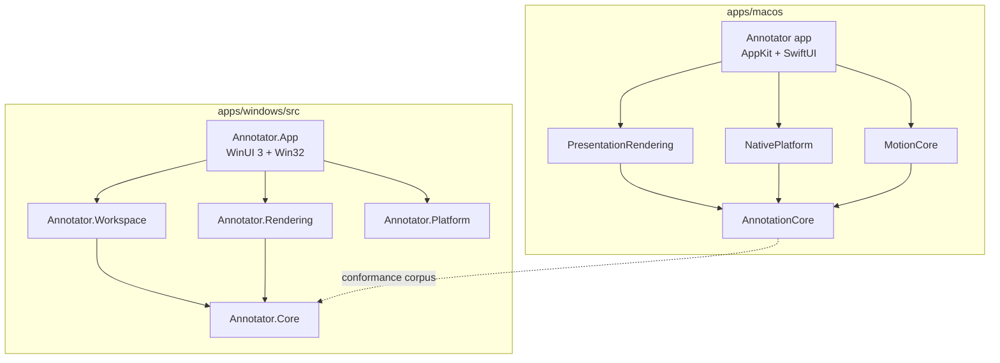

# Architecture

Annotator draws on the live desktop. There is one product and two native apps:
Swift on macOS and C# on Windows. The Mac app is the behavioral reference; the
[parity contract](parity.md) says how Windows matches it.

## Product rules

- Annotations live on the live desktop only. There is no standalone image
  editor, OCR or QR reader, export-area editor, image backdrop workspace or
  screen recorder. Pasted and inserted images become annotation layers on the
  desktop.
- Image-backed canvas hosts exist only in tests. Marketing captures use the
  real desktop overlay.
- Drawings, screen pixels and keystrokes stay on the computer. Usage counts are
  off until the person turns them on, and never include drawing content.
- Every feature is free. No code checks a licence or paid status.
- Masks fail closed: if capture fails, a Blur, Pixelate or Distort region turns
  opaque. It never shows unfiltered pixels. Input is always released on Use
  apps, Hide and suspension.

## Layers

| Mac (`apps/macos`) | Windows (`apps/windows/src`) | Holds |
| --- | --- | --- |
| `Sources/AnnotationCore` | `Annotator.Core` | Document model, elements, geometry, shortcuts, preferences, file formats. No UI, platform or network code. |
| `Sources/MotionCore` | `Annotator.Core/Motion` | Animation curves and timings. |
| `Sources/PresentationRendering` | `Annotator.Rendering` | Scene drawing, pixel effects, spotlight, cursor highlight, export. |
| `Sources/NativePlatform` | `Annotator.Platform` | Display capture, window lists, global input hooks and other OS services. |
| `Annotator/` (`WorkspaceModel.swift` and views) | `Annotator.Workspace` + `Annotator.App` | Workspace state and the app's windows. Windows splits UI-free workspace logic from the WinUI app. |

Keep `AnnotationCore` free of AppKit, SwiftUI and networking.
Keep `Annotator.Core` and `Annotator.Workspace` free of Windows and UI
dependencies, so they build and test on any OS. Native UI state is
main-actor (Mac) or UI-thread (Windows) isolated.

## Where features live

| Feature | Mac | Windows |
| --- | --- | --- |
| Desktop overlay and input | `DrawingCanvas.swift`, `SelectionOverlay.swift`, `WorkspaceModel.swift` | `App/Overlay`, `Platform/Overlays`, `Platform/Input`, `Workspace/Canvas` |
| Tools, styles and the toolbar | `AnnotationCore/Element.swift`, `ToolStyleDefaults.swift`, `ToolbarView.swift`, `ContextualInspector.swift` | `Core/Element.cs`, `Workspace/Toolbar`, `App/Toolbar`, `App/Pickers` |
| Effects (Blur, Pixelate, Distort) | `PresentationRendering/PixelEffectsView.swift`, `CaptureCompositor.swift`, `NativePlatform/DisplayCapture.swift` | `Rendering/Effects`, `Platform/Capture`, `Workspace/Capture` |
| Zoom and pointer lens | `LivePresentation.swift`, `ZoomStartController.swift`, `LiveZoomControls.swift` | `Rendering/Zoom`, `Workspace/Zoom` |
| Spotlight and cursor halo | `SpotlightRenderer.swift`, `CursorHighlightRenderer.swift`, `CursorClickAnimation.swift` | `Rendering/Presentation`, `Workspace/Pointer` |
| Region sharing | `RegionSharingController.swift`, `SharedRegionWindow.swift`, `AnnotationCore/SharingRegion.swift` | `App/Sharing`, `Workspace/Sharing`, `Platform/Sharing`, `Rendering/Sharing` |
| Break timer | `BreakTimerController.swift`, `BreakScreenView.swift`, `AnnotationCore/BreakTimer.swift` | `Core/BreakTimer.cs`, `Workspace/Breaks`, `App/Breaks` |
| Settings and shortcuts | `SettingsView.swift`, `ToolbarShortcutSettings.swift`, `AnnotationCore/Preferences.swift`, `Shortcuts.swift` | `Core/Preferences.cs`, `Workspace/Settings`, `Workspace/Shortcuts`, `App/Settings` |
| Boards, saved shapes, export | `ShapeLibraryModel.swift`, `ToolLibrary.swift`, `SnapshotExporter.swift` | `Workspace/Files`, `Workspace/Library`, `App/Library`, `Rendering/Export` |
| First use and help | `AnnotationCore/Tutorial.swift`, `TutorialController.swift`, `FeedbackView.swift`, `SupportInfo.swift` | `Core/Tutorial`, `Workspace/FirstUse`, `App/Tutorial`, `Workspace/Settings` |
| Updates | Sparkle (`AppUpdateController.swift`) | Microsoft Store, `Workspace/Updates`, `Platform/Updates` |
| Usage counts (opt-in) | `UsageMetrics.swift` | `Workspace/Metrics`; service in `services/metrics` |
| AI control | `ComputerUseSkill.swift`, [`integrations/computer-use/annotator`](../integrations/computer-use/annotator/SKILL.md) | Same skill, bundled with the app |

## Behavior worth knowing before you change it

- **Editing**: a gesture starts one transaction and commits one Undo step;
  cancelling restores the scene and keeps Redo. Locked objects resist editing
  and erasing. Copy and paste use the same path as Duplicate. Hit testing
  follows the visible stack, except that text inside an outline shape stays
  clickable.
- **Displays**: each display has its own document and overlay. Drawing mode
  prepares every display; clicking a canvas makes it the target without moving
  the toolbar. Dragging a selection to another display moves it there in one
  Undo step.
- **Effects**: regions stay where they are placed. They do not follow windows
  or scrolling. Capture runs
  only while pixels are needed and leaves Annotator's own windows out.
- **Zoom**: screen zoom anchors at the pointer, and clicks reach the control
  under the pointer.
- **Region sharing**: one region on one display at a time, shown in one
  window, **Annotator - Shared Region**, that people pick in their meeting app.
  A missing display or invalid region is never silently replaced.
- **Break timer**: no app can draw on the lock screen. The break screen covers
  every display, and the first real input locks the computer with the system
  lock.
- **Usage counts**: off by default; turning them on creates a random install
  ID, turning them off deletes it and any queued counts.
- **Motion**: animations are owned, bounded and cancelled when hidden. Reduce
  Motion (Mac) and animation effects off (Windows) replace movement with brief
  static emphasis.

## Decisions

These choices shape the code. Revisit them in an issue before changing them.

- **Open source, no paid tier.** Apache-2.0. The name and icon are covered by
  [TRADEMARK.md](../TRADEMARK.md).
- **Independent native code.** Both apps are written for this project. No
  code, assets or tests come from ZoomIt, PowerToys or GPL projects.
- **Two native apps, one behavior.** Windows uses C# with Native AOT, WinUI 3
  for app windows and Win32 with Windows.UI.Composition, Direct2D and
  Direct3D 11 for the overlay; no browser runtime ([parity.md](parity.md#owner-decisions), D-2).
- **Static effects.** Blur, Pixelate and Distort regions stay where they are
  placed; window following was removed because a moving window can't be
  tracked safely.
- **Pointer-anchored zoom.** Screen zoom keeps the point under the pointer
  fixed, and clicks reach what is under the pointer.
- **Shortcut-first interface.** One Toolbar & Shortcuts editor, one shared
  style for each tool, and short purposeful motion that respects Reduce
  Motion.
- **One website, opt-in counts.** The site, the usage-count functions and the
  dashboard share one Netlify origin; the old GitHub Pages address keeps
  serving update feeds for old copies ([maintainers/website.md](maintainers/website.md)).

## Former specification and decision numbers

Annotator used numbered specifications and decision records (ADRs) until it
went open source. Code comments and tests still cite them. The live rules
moved into this page, [parity.md](parity.md) and [releasing.md](releasing.md);
the full text stays in the history of the archived `annotator-code`
repository.

| Number | Area |
| --- | --- |
| 000 | Product scope and invariants (this page, Product rules) |
| 001 | Annotation model and editing |
| 002 | Desktop overlay, displays and input |
| 003 | Presentation effects: zoom, lens, spotlight, cursor halo, click effects, board backgrounds; performance budgets ([performance](performance/README.md)) |
| 004 | Window-following masks (retired; effects are static) |
| 005 | Workflows: toolbar and shortcuts, boards, saved shapes, shape labels, launch at login |
| 006 | Licensing (removed) |
| 007 | Website and distribution ([releasing.md](releasing.md)) |
| 008 | Effects, counters, rulers and PNG output (image workspace removed) |
| 009 | Unified editing, feedback and screen zoom |
| 010 | Agent draft files (removed; AI control uses the computer-use skill) |
| 011 | Opt-in usage counts |
| 012 | Region sharing |
| 013 | Windows edition ([parity.md](parity.md)) |
| 014 | Break timer |

| ADR | Decision |
| --- | --- |
| 0001 | Independent native foundation |
| 0002 | Licensing prototype (removed) |
| 0003 | Toolbar and properties design |
| 0004 | Pointer-anchored screen zoom |
| 0005 | Static effect regions |
| 0006 | Editing across displays |
| 0007 | Release automation (replaced by the open-source release workflow) |
| 0008 | Shortcut-first interface and website motion |
| 0009 | Opt-in usage counts |
| 0010 | One Netlify site and the Pages feed bridge |
| 0011 | Color paint and guided discovery |
| 0012 | Toolbar & Shortcuts editor and shared style |
| 0013 | Region sharing window |
| 0014 | Native Windows edition |
| 0015 | Open source under Apache-2.0 |
