# Live macOS recordings

Generated by `tools/ux_reference.py pack-live`. Read [the README](../README.md) first. These are real-time
recordings of the live desktop at the display's own scale (1x here), played back at real speed. Each video has
a JSON file with its events and timed segments, and a contact sheet of frames at each segment's start, quarters
and end.

## Show and hide

Each workspace show and hide style with seven drawings and the toolbar, and a reversal mid-way.

### `show-hide-corners`

Hide tools (Control-Option-2 path), then show them again (Control-Shift-2 path), with seven drawings on the canvas. 4.01 s, 1440 x 900 pixels at 1x. [Video](show-hide-corners.mp4) · [details](show-hide-corners.json)

Segments: hide 0.63-1.56 s, show 2.17-3.22 s.

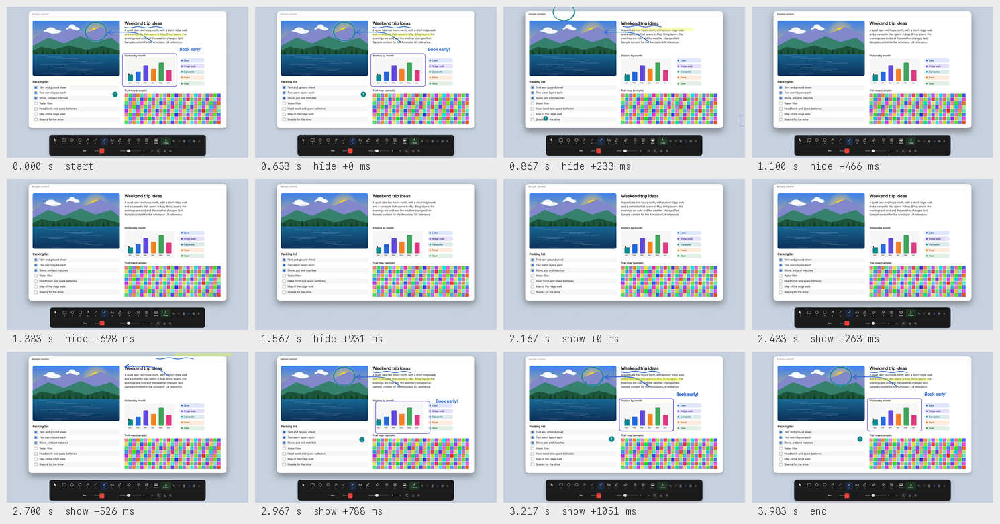

### `show-hide-dissolve`

Hide tools (Control-Option-2 path), then show them again (Control-Shift-2 path), with seven drawings on the canvas. 4.32 s, 1440 x 900 pixels at 1x. [Video](show-hide-dissolve.mp4) · [details](show-hide-dissolve.json)

Segments: hide 0.64-1.72 s, show 2.34-3.48 s.

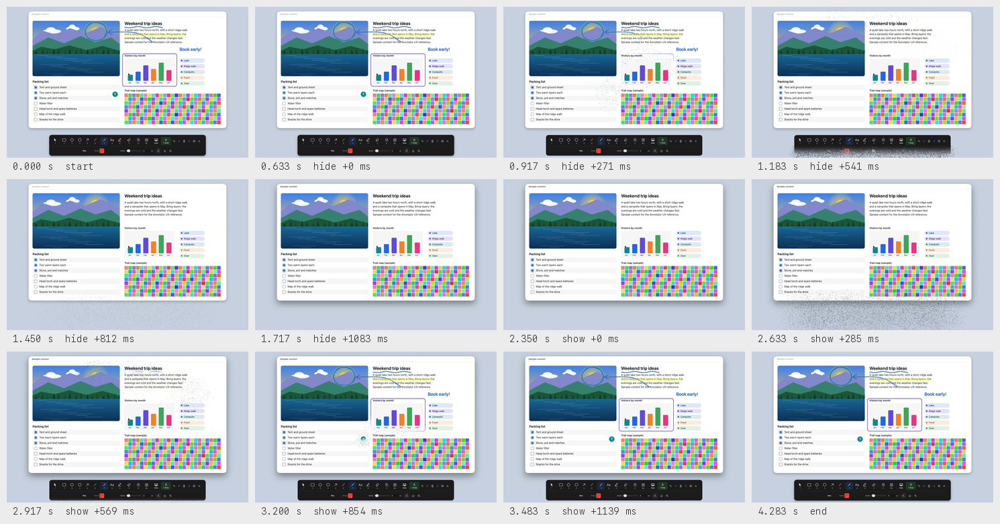

### `show-hide-drop`

Hide tools (Control-Option-2 path), then show them again (Control-Shift-2 path), with seven drawings on the canvas. 3.64 s, 1440 x 900 pixels at 1x. [Video](show-hide-drop.mp4) · [details](show-hide-drop.json)

Segments: hide 0.64-1.40 s, show 2.02-2.82 s.

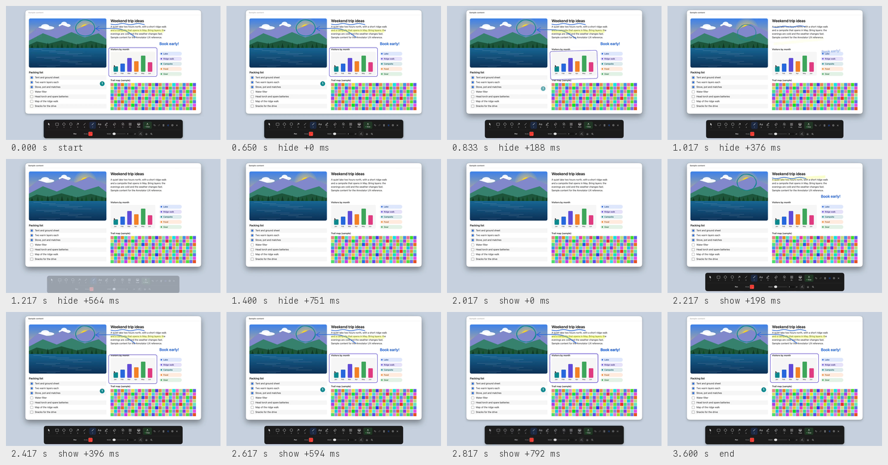

### `show-hide-fade`

Hide tools (Control-Option-2 path), then show them again (Control-Shift-2 path), with seven drawings on the canvas. 2.71 s, 1440 x 900 pixels at 1x. [Video](show-hide-fade.mp4) · [details](show-hide-fade.json)

Segments: hide 0.62-0.89 s, show 1.53-1.91 s.

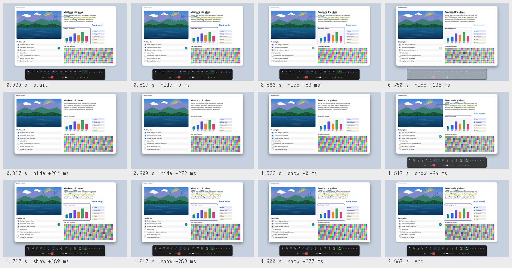

### `show-hide-focus`

Hide tools (Control-Option-2 path), then show them again (Control-Shift-2 path), with seven drawings on the canvas. 3.53 s, 1440 x 900 pixels at 1x. [Video](show-hide-focus.mp4) · [details](show-hide-focus.json)

Segments: hide 0.64-1.34 s, show 1.98-2.74 s.

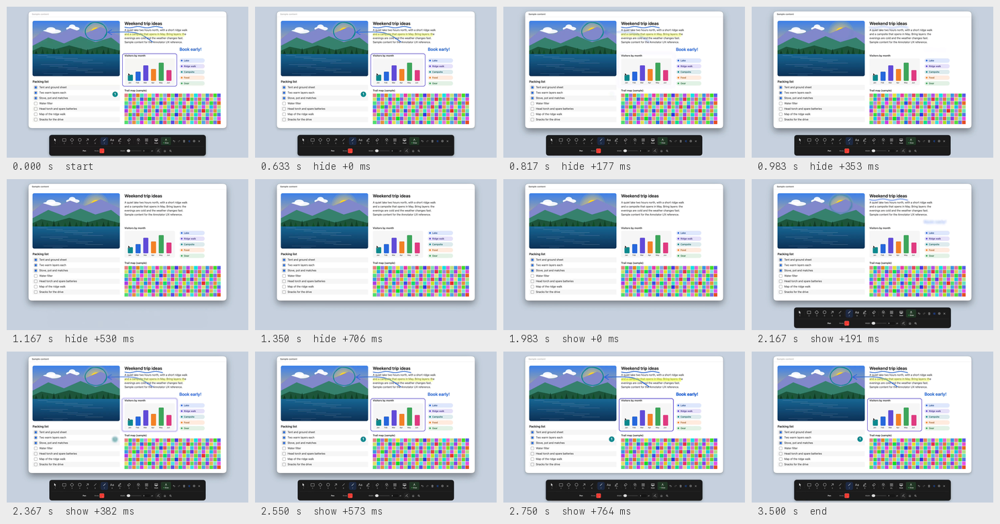

### `show-hide-magic`

Hide tools (Control-Option-2 path), then show them again (Control-Shift-2 path), with seven drawings on the canvas. 4.51 s, 1440 x 900 pixels at 1x. [Video](show-hide-magic.mp4) · [details](show-hide-magic.json)

Segments: hide 0.62-1.66 s, show 2.29-3.69 s.

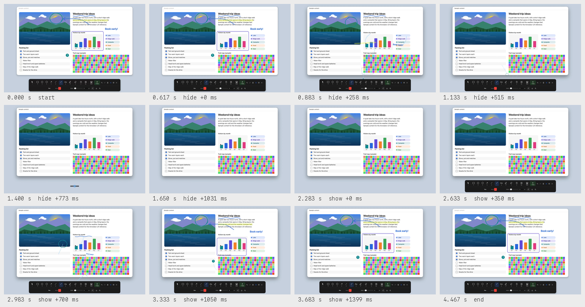

### `show-hide-none`

Hide tools (Control-Option-2 path), then show them again (Control-Shift-2 path), with seven drawings on the canvas. 2.21 s, 1440 x 900 pixels at 1x. [Video](show-hide-none.mp4) · [details](show-hide-none.json)

Segments: hide 0.62-0.69 s, show 1.32-1.40 s.

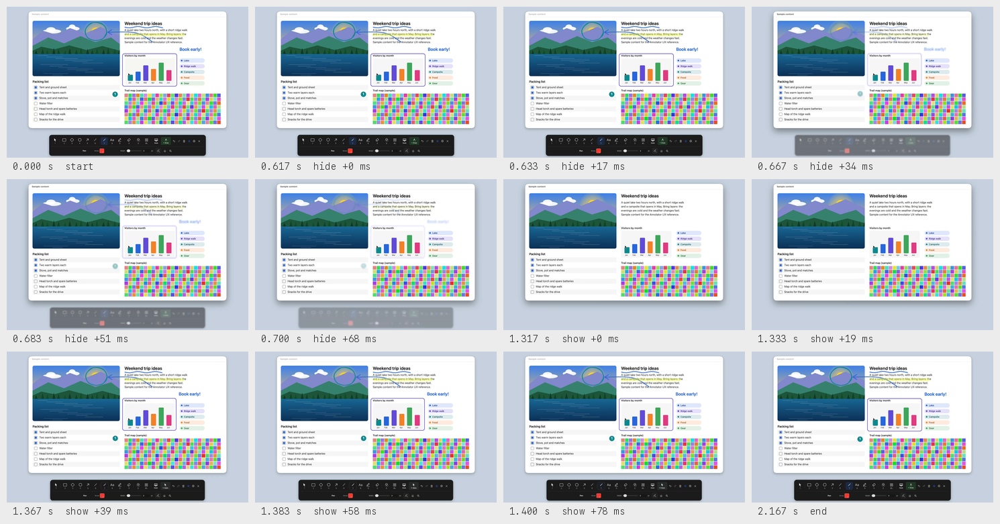

### `show-hide-pop`

Hide tools (Control-Option-2 path), then show them again (Control-Shift-2 path), with seven drawings on the canvas. 3.48 s, 1440 x 900 pixels at 1x. [Video](show-hide-pop.mp4) · [details](show-hide-pop.json)

Segments: hide 0.63-1.31 s, show 1.94-2.68 s.

### `show-hide-reversal`

Slide style. Showing again at 45% of the hide reverses from the current position. 1.96 s, 1440 x 900 pixels at 1x. [Video](show-hide-reversal.mp4) · [details](show-hide-reversal.json)

Segments: hide, reversed mid-way 0.63-1.18 s.

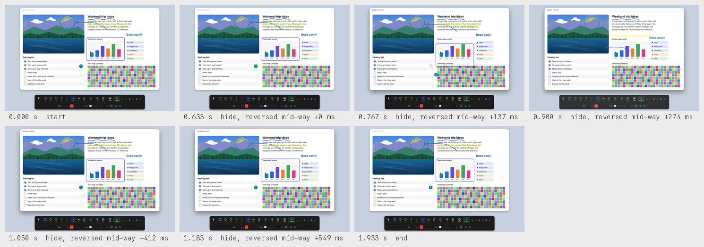

### `show-hide-slide`

Hide tools (Control-Option-2 path), then show them again (Control-Shift-2 path), with seven drawings on the canvas. 4.03 s, 1440 x 900 pixels at 1x. [Video](show-hide-slide.mp4) · [details](show-hide-slide.json)

Segments: hide 0.63-1.57 s, show 2.21-3.23 s.

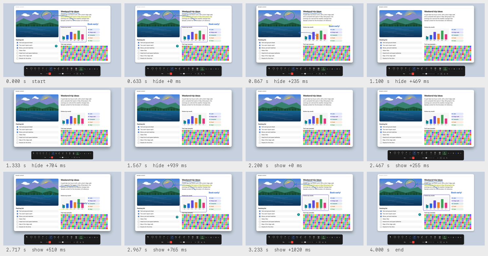

## Live zoom

Screen zoom ramping in, following the pointer, zooming further and ramping out; the pointer lens.

### `zoom-lens`

The pointer lens turns on, follows the pointer across fine detail and turns off. 5.87 s, 1440 x 900 pixels at 1x. [Video](zoom-lens.mp4) · [details](zoom-lens.json)

Segments: lens on 0.93-1.24 s, lens follows the pointer 1.24-4.47 s, lens off 4.87-5.29 s.

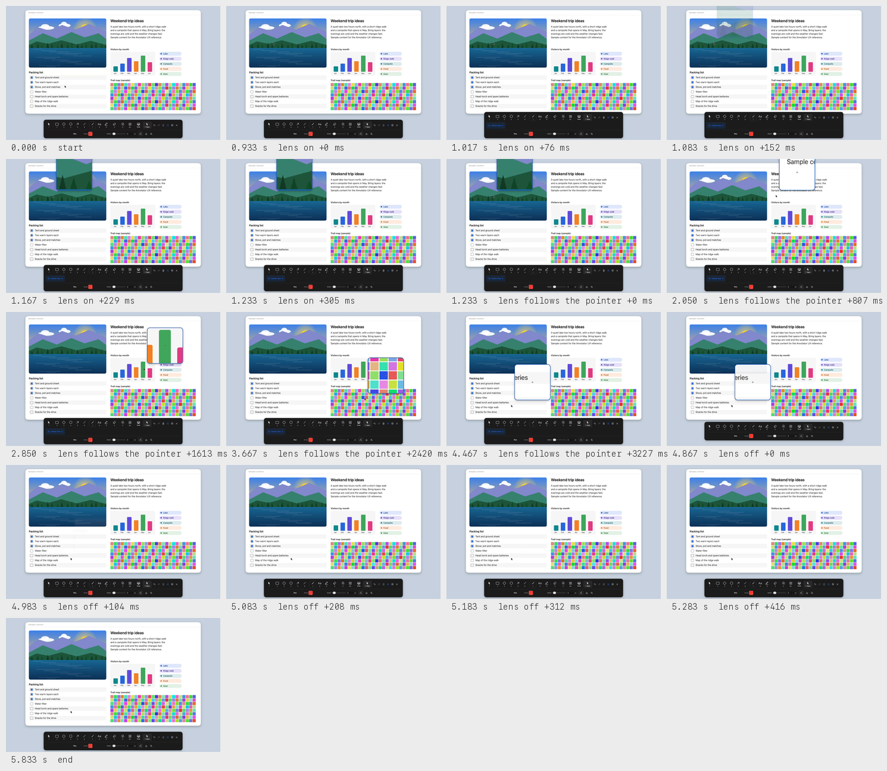

### `zoom-screen`

Control-1 path from drawing: zoom ramps in around the pointer, follows it, zooms further, then ramps out. 7.85 s, 1440 x 900 pixels at 1x. [Video](zoom-screen.mp4) · [details](zoom-screen.json)

Segments: zoom in 1.09-1.56 s, pointer moves while zoomed 2.36-4.72 s, zoom further 5.12-6.01 s, zoom out 6.81-7.05 s.

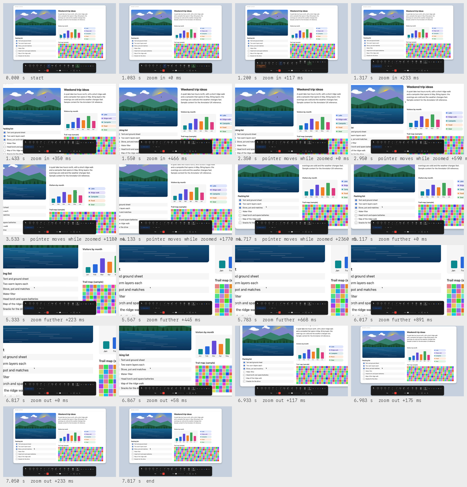

## Live effects

Blur, pixelate and distort over the owned sample desktop, a strength change, an existing solid cover and Use apps.

### `effects-live`

Blur, pixelate and distort are dragged over owned sample content. Then the blur strength changes, a solid cover from an existing board overlaps the blur (the toolbar no longer creates solid covers), and Use apps keeps the effects on the desktop. 14.03 s, 1440 x 900 pixels at 1x. [Video](effects-live.mp4) · [details](effects-live.json)

Segments: blur 0.94-2.29 s, pixelate 3.60-5.00 s, distort 6.31-7.59 s, blur strength 18 to 60 to 4 9.00-10.62 s, existing solid cover over the blur 11.42-11.83 s, use apps 12.84-14.04 s.

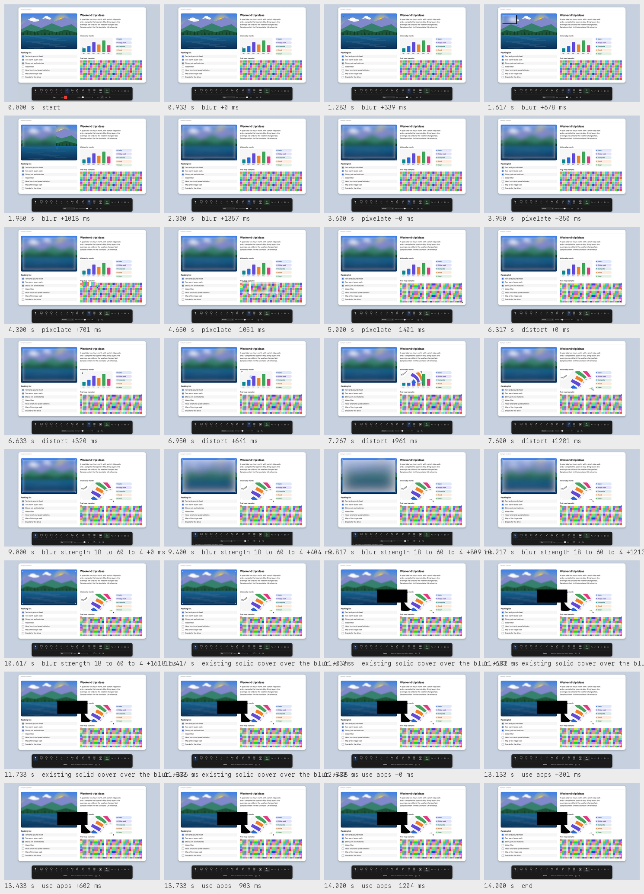

## Region sharing

The desktop while a region is shared, and the output window people share in a call.

### `sharing-live`

The shared region outline on the desktop while the owner draws, adds a blur, hides and shows the workspace, then stops sharing. sharing-output records the output window at the same time. 15.62 s, 1440 x 900 pixels at 1x. [Video](sharing-live.mp4) · [details](sharing-live.json)

Segments: draw again 1.03-1.54 s, pen stroke in the region 1.54-4.14 s, arrow in the region 4.96-6.71 s, blur in the region 7.53-9.63 s, hide 10.63-11.63 s, show 12.24-13.63 s, stop sharing 14.44-15.65 s.

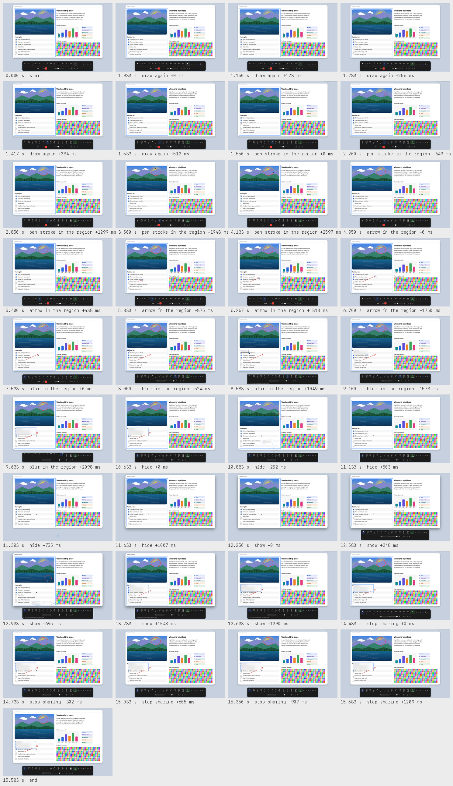

### `sharing-output`

The output window people share in a call, recorded with the sharing-live take. Its clock starts 0.160 s before sharing-live. 15.93 s, 720 x 472 pixels at 1x. [Video](sharing-output.mp4) · [details](sharing-output.json)

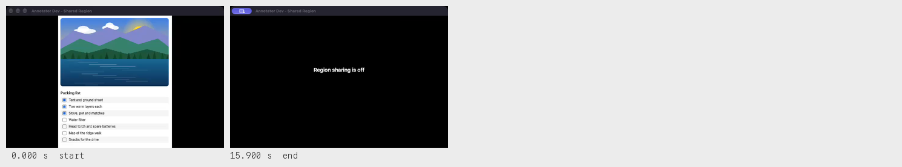
