# macOS UX reference gallery

Generated by `tools/ux_reference.py`. Read [the README](../README.md) first. Images are 2x;
sizes below are in points (one point is one Windows DIP). Each image has a JSON file with the same
name holding its accessibility tree.

## Toolbar

The floating toolbar in every layout, size, mode and tool state. Compare with WIN-UI-02.

| State | Light | Dark |
| --- | --- | --- |
| `added-buttons` 1272 x 123 pt Spotlight, Cursor halo, Pointer lens, Smart draw, Share region, Blur and Pixelate added. | 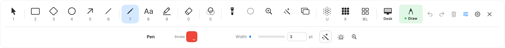 | 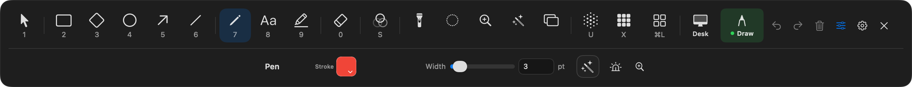 |
| `board-blackboard` 932 x 175 pt Board button after choosing Blackboard. | 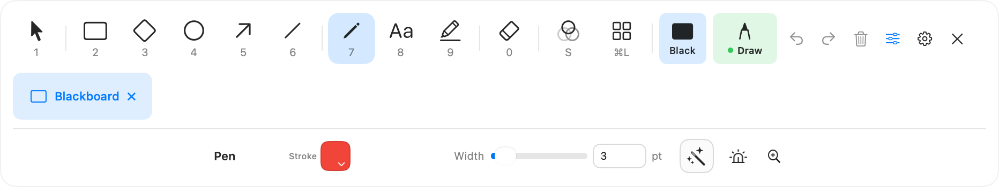 | 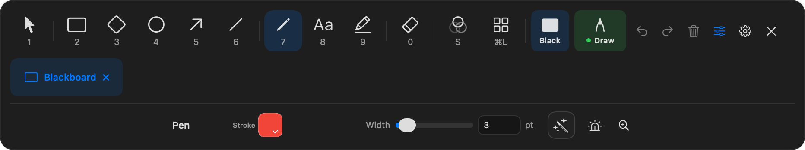 |
| `board-whiteboard` 932 x 175 pt Board button after choosing Whiteboard. | 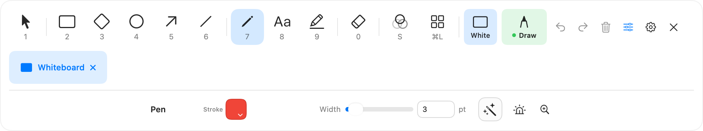 | 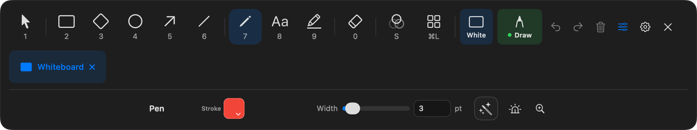 |
| `capture-failure` 932 x 144 pt A capture failure warning in the toolbar; effect regions stay opaque. | 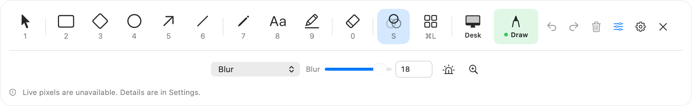 | 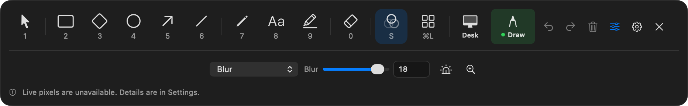 |
| `draw-quick-arrow` 932 x 123 pt Expanded toolbar with quick properties for Arrow. | 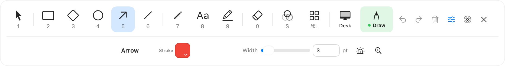 | 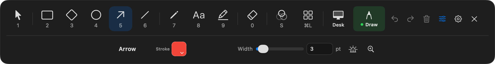 |
| `draw-quick-blur` 932 x 123 pt Expanded toolbar with quick properties for Blur region. | 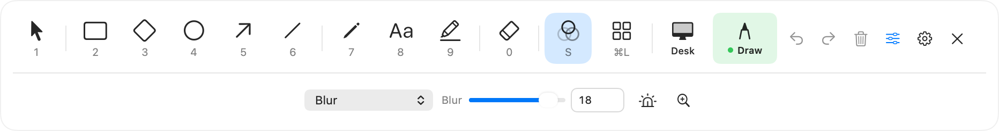 | 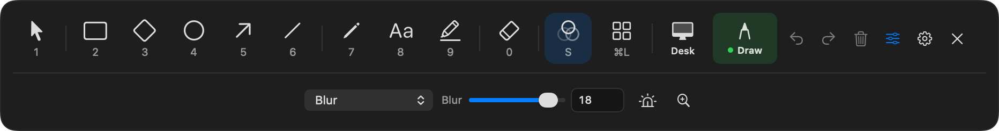 |
| `draw-quick-counter` 932 x 123 pt Expanded toolbar with quick properties for Numbered counter. | 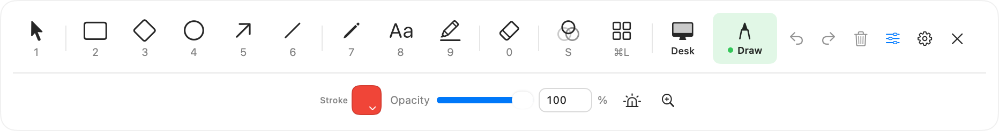 | 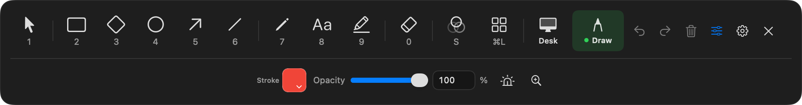 |
| `draw-quick-databaseStack` 932 x 123 pt Expanded toolbar with quick properties for Database. | 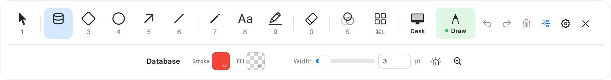 | 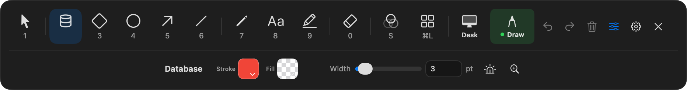 |
| `draw-quick-diamond` 932 x 123 pt Expanded toolbar with quick properties for Diamond. | 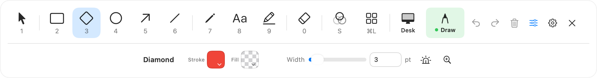 | 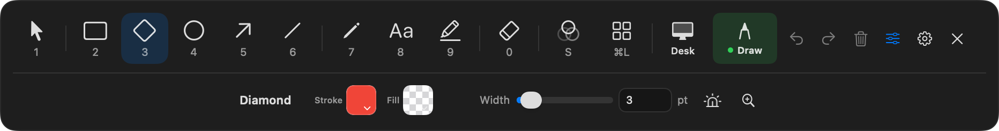 |
| `draw-quick-distort` 932 x 123 pt Expanded toolbar with quick properties for Distort region. | 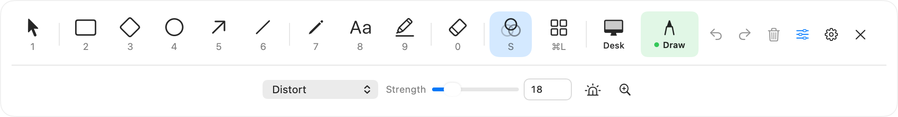 | 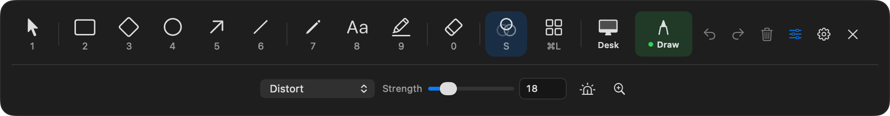 |
| `draw-quick-ellipse` 932 x 123 pt Expanded toolbar with quick properties for Ellipse. | 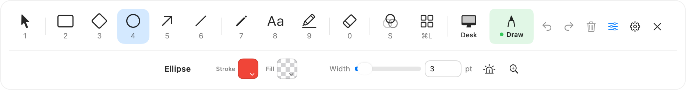 | 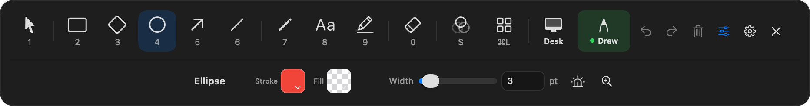 |
| `draw-quick-eraser` 932 x 123 pt Expanded toolbar with quick properties for Eraser. | 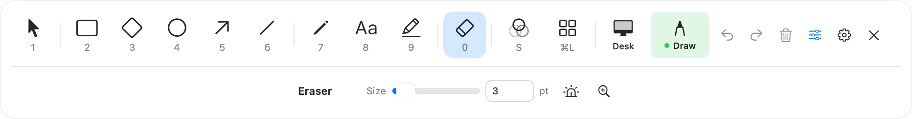 | 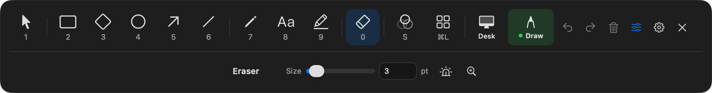 |
| `draw-quick-highlighter` 932 x 123 pt Expanded toolbar with quick properties for Highlighter. | 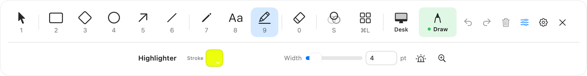 | 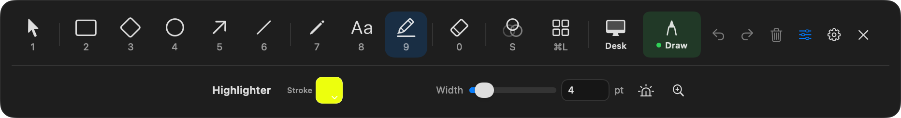 |
| `draw-quick-image` 932 x 123 pt Expanded toolbar with quick properties for Paste image. | 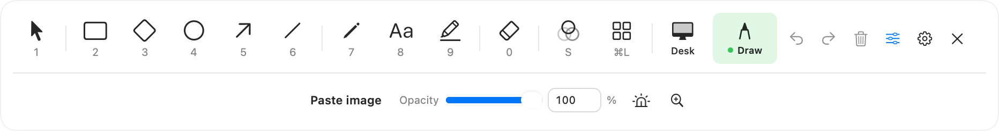 | 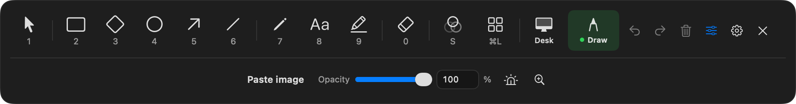 |
| `draw-quick-line` 932 x 123 pt Expanded toolbar with quick properties for Line. | 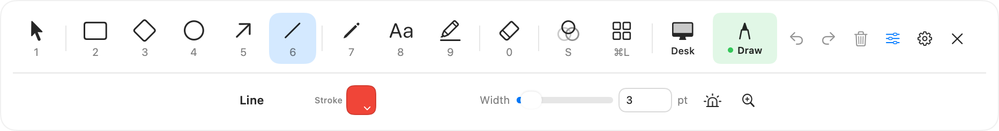 | 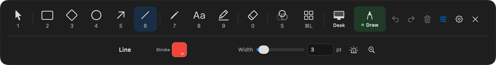 |
| `draw-quick-pen` 932 x 123 pt Expanded toolbar with quick properties for Pen. |  |  |
| `draw-quick-pixelate` 932 x 123 pt Expanded toolbar with quick properties for Pixelate region. | 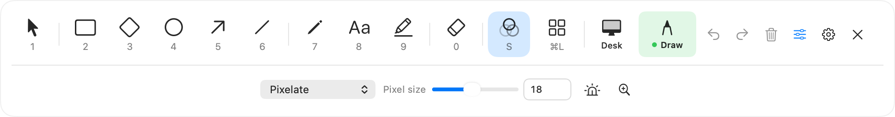 | 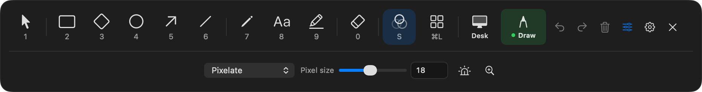 |
| `draw-quick-rectangle` 932 x 123 pt Expanded toolbar with quick properties for Rectangle. | 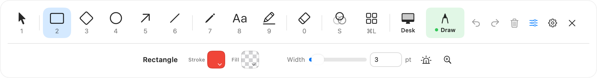 | 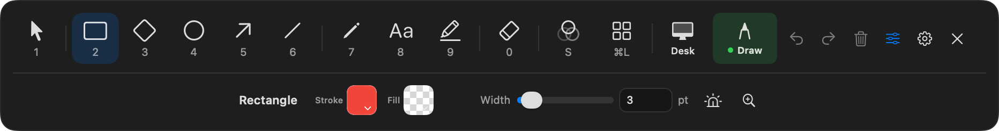 |
| `draw-quick-rectangle-filled` 932 x 123 pt Rectangle with Fill on: the fill pattern control appears. | 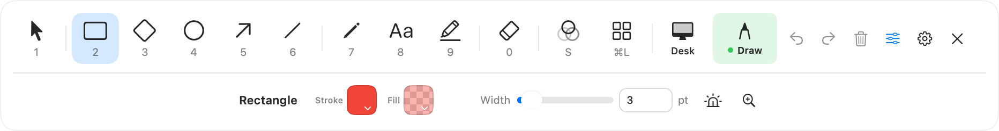 | 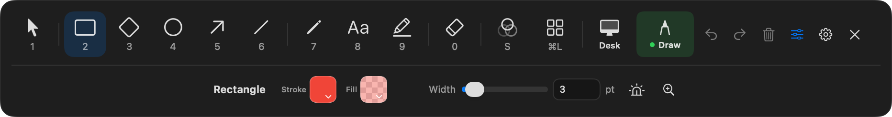 |
| `draw-quick-ruler` 932 x 123 pt Expanded toolbar with quick properties for Pixel ruler. | 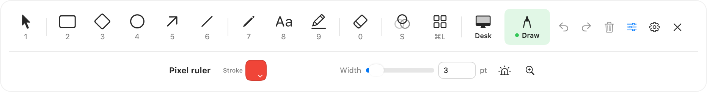 | 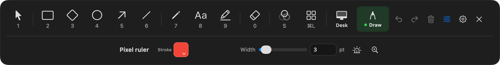 |
| `draw-quick-select` 932 x 123 pt Expanded toolbar with quick properties for Select. | 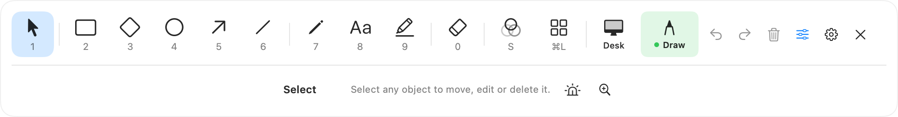 | 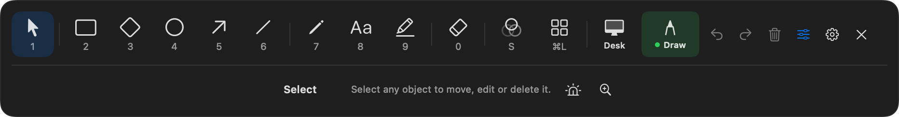 |
| `draw-quick-text` 932 x 123 pt Expanded toolbar with quick properties for Text. | 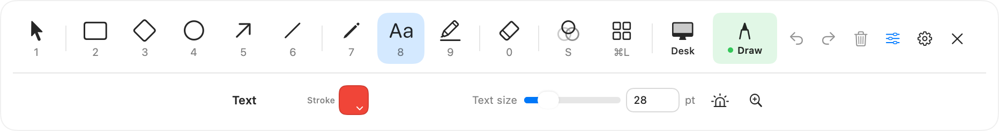 | 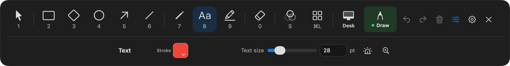 |
| `draw-tools-only` 932 x 72 pt Tools only: quick properties collapsed. |  | 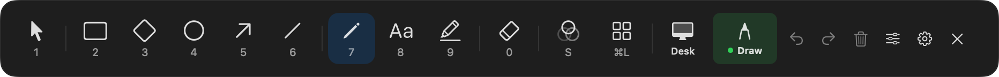 |
| `expanded-horizontal-quick` 932 x 123 pt Expanded toolbar, horizontal, quick properties. Pen selected. | 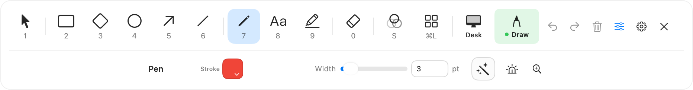 | 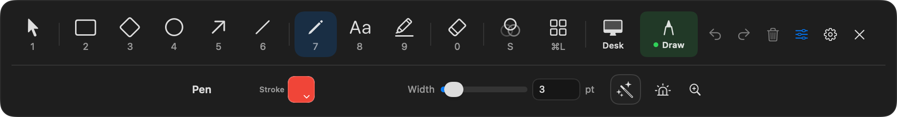 |
| `expanded-horizontal-tools-only` 932 x 72 pt Expanded toolbar, horizontal, tools only. Pen selected. | 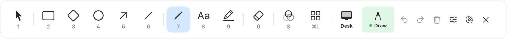 |  |
| `expanded-vertical-quick` 376 x 541 pt Expanded toolbar, vertical, quick properties. Pen selected. | 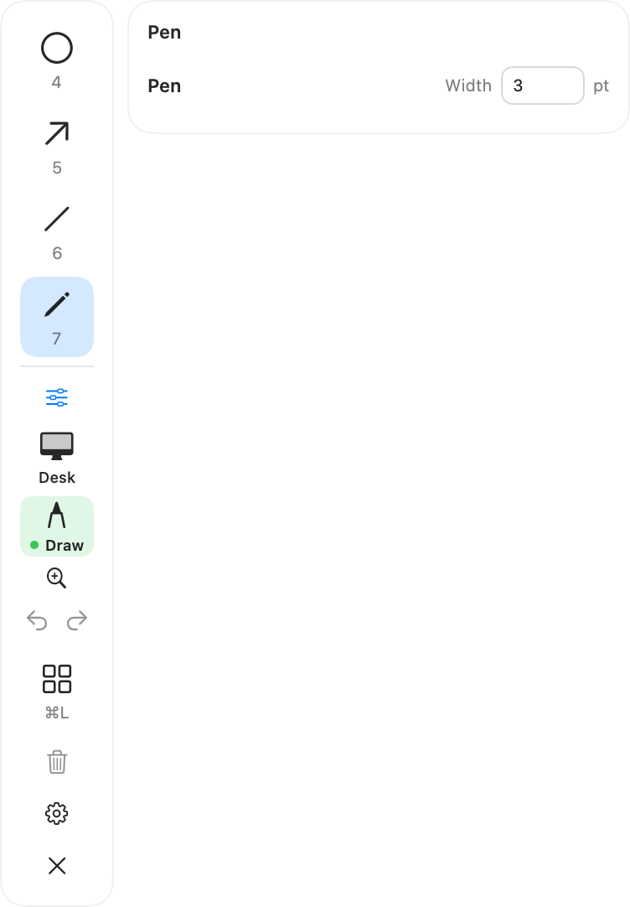 | 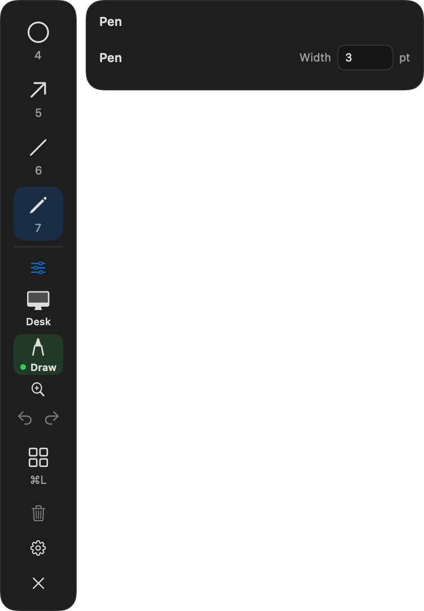 |
| `expanded-vertical-tools-only` 68 x 541 pt Expanded toolbar, vertical, tools only. Pen selected. | 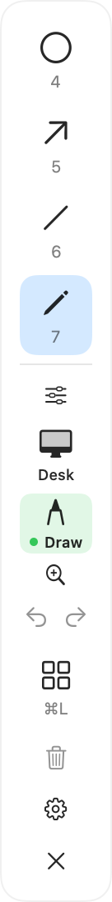 | 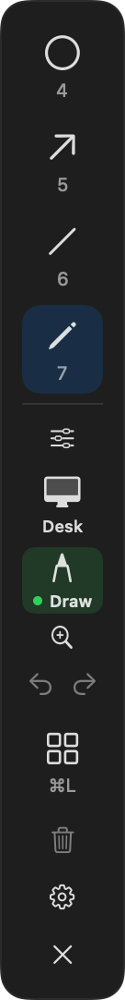 |
| `fit-narrow` 400 x 115 pt Toolbar fitted into 400 x 600 points. |  |  |
| `fit-short` 648 x 115 pt Toolbar fitted into 648 x 230 points. |  |  |
| `full-properties-arrow` 932 x 258 pt Full properties open inside the toolbar panel, below the rail. |  |  |
| `full-properties-blur` 932 x 133 pt Full properties open inside the toolbar panel, below the rail. |  |  |
| `full-properties-pen` 932 x 172 pt Full properties open inside the toolbar panel, below the rail. |  |  |
| `full-properties-rectangle` 932 x 172 pt Full properties open inside the toolbar panel, below the rail. |  |  |
| `full-properties-text` 932 x 172 pt Full properties open inside the toolbar panel, below the rail. |  |  |
| `full-properties-vertical-arrow` 376 x 616 pt Vertical rail with full properties beside it. |  |  |
| `minimal-horizontal-quick` 738 x 103 pt Minimal toolbar, horizontal, quick properties. Pen selected. |  |  |
| `minimal-horizontal-tools-only` 738 x 52 pt Minimal toolbar, horizontal, tools only. Pen selected. |  |  |
| `minimal-vertical-quick` 358 x 542 pt Minimal toolbar, vertical, quick properties. Pen selected. |  |  |
| `minimal-vertical-tools-only` 50 x 542 pt Minimal toolbar, vertical, tools only. Pen selected. |  |  |
| `off` 932 x 123 pt Before drawing starts. The mode control offers Draw. |  |  |
| `selection-locked` 932 x 123 pt A locked object selected: Unlock is offered. |  |  |
| `selection-multiple` 932 x 123 pt Two shapes selected: shared style controls. |  |  |
| `selection-single` 932 x 123 pt One shape selected with Select. |  |  |
| `shared-style` 932 x 123 pt Share style between tools is on: quick properties show the link mark. |  |  |
| `use-apps` 932 x 123 pt Use apps: other apps get the clicks; the remembered tool keeps a neutral outline. |  |  |

## Full properties

The properties panel for each tool, 648 points wide unless noted.

| State | Light | Dark |
| --- | --- | --- |
| `arrow` 648 x 201 pt Full properties for Arrow, 648 points wide. |  |  |
| `arrow-curved` 648 x 201 pt Curved arrow. |  |  |
| `blur` 648 x 76 pt Full properties for Blur region, 648 points wide. |  |  |
| `counter` 648 x 88 pt Full properties for Numbered counter, 648 points wide. |  |  |
| `diamond` 648 x 185 pt Full properties for Diamond, 648 points wide. |  |  |
| `diamond-wide` 932 x 115 pt Wide layout: one row. |  |  |
| `distort` 648 x 76 pt Full properties for Distort region, 648 points wide. |  |  |
| `ellipse` 648 x 115 pt Full properties for Ellipse, 648 points wide. |  |  |
| `eraser` 648 x 115 pt Full properties for Eraser, 648 points wide. |  |  |
| `highlighter` 648 x 115 pt Full properties for Highlighter, 648 points wide. |  |  |
| `line` 648 x 115 pt Full properties for Line, 648 points wide. |  |  |
| `pen` 648 x 185 pt Full properties for Pen, 648 points wide. |  |  |
| `pen-smart-draw` 648 x 185 pt Pen with Smart draw on. |  |  |
| `pixelate` 648 x 76 pt Full properties for Pixelate region, 648 points wide. |  |  |
| `rectangle` 648 x 185 pt Full properties for Rectangle, 648 points wide. |  |  |
| `rectangle-filled` 648 x 185 pt Fill on: fill pattern and opacity appear. |  |  |
| `ruler` 648 x 142 pt Full properties for Pixel ruler, 648 points wide. |  |  |
| `text` 648 x 115 pt Full properties for Text, 648 points wide. |  |  |

## Pickers and zoom controls

Color popover, arrowhead choices and zoom controls.

| State | Light | Dark |
| --- | --- | --- |
| `arrowhead-end` 193 x 319 pt Arrowhead choices for the end. |  |  |
| `arrowhead-start` 193 x 319 pt Arrowhead choices for the start. |  |  |
| `color-fill` 284 x 511 pt Fill color popover. |  |  |
| `color-gradient` 284 x 351 pt Stroke with the spectrum gradient preset. |  |  |
| `color-stroke` 284 x 487 pt Stroke color popover, 284 points wide. Shown in a system popover. |  |  |
| `zoom-compact` 68 x 67 pt Compact zoom controls from the toolbar. |  |  |
| `zoom-full` 169 x 50 pt Zoom controls in full properties. |  |  |

## Menu-bar menu and icon

The menu-bar popover (the Windows tray flyout) and the menu-bar icon. Compare with WIN-UI-01.

| State | Light | Dark |
| --- | --- | --- |
| `developer-preview` 320 x 713 pt Development build: the Developer preview badge. |  |  |
| `drawing` 320 x 725 pt Tools visible, drawing. |  |  |
| `status-item` 24 x 22 pt Menu-bar icon. The template glyph is black on a light menu bar and white on a dark one. The accessibility tree is the app's configured status button. |  |  |
| `status-item-sharing` 24 x 22 pt Menu-bar icon. The template glyph is black on a light menu bar and white on a dark one; the red dot shows while region sharing is on. The accessibility tree is the app's configured status button. |  |  |
| `tools-hidden` 320 x 689 pt Release build, drawings and tools hidden. |  |  |
| `updates-unavailable` 320 x 739 pt Update checks unavailable: the reason shows under the button. |  |  |
| `using-apps` 320 x 725 pt Tools visible, Use apps. |  |  |

## Settings

Every Settings tab at its default size, the same tab stretched to show all of its content, and the launch-at-login states.

| State | Light | Dark |
| --- | --- | --- |
| `launch-at-login-enabled` 620 x 116.5 pt Launch at login, enabled. Windows maps these to the startup task states (WIN-SYS-01). |  |  |
| `launch-at-login-not-found` 620 x 116.5 pt Launch at login, not-found. Windows maps these to the startup task states (WIN-SYS-01). |  |  |
| `launch-at-login-off` 620 x 116.5 pt Launch at login, off. Windows maps these to the startup task states (WIN-SYS-01). |  |  |
| `launch-at-login-requires-approval` 620 x 116.5 pt Launch at login, requires-approval. Windows maps these to the startup task states (WIN-SYS-01). |  |  |
| `tab-about` 840 x 700 pt Settings, about tab, at its default size. Content below the fold scrolls. |  |  |
| `tab-about-full` 840 x 1500 pt Settings, about tab, stretched to 1500 points so the whole scrolling content shows. |  |  |
| `tab-breakTimer` 840 x 700 pt Settings, breakTimer tab, at its default size. Content below the fold scrolls. |  |  |
| `tab-breakTimer-full` 840 x 1500 pt Settings, breakTimer tab, stretched to 1500 points so the whole scrolling content shows. |  |  |
| `tab-general` 840 x 700 pt Settings, general tab, at its default size. Content below the fold scrolls. |  |  |
| `tab-general-full` 840 x 1500 pt Settings, general tab, stretched to 1500 points so the whole scrolling content shows. |  |  |
| `tab-help` 840 x 700 pt Settings, help tab, at its default size. Content below the fold scrolls. |  |  |
| `tab-help-full` 840 x 1500 pt Settings, help tab, stretched to 1500 points so the whole scrolling content shows. |  |  |
| `tab-permissions` 840 x 700 pt Settings, permissions tab, at its default size. Content below the fold scrolls. |  |  |
| `tab-permissions-full` 840 x 1500 pt Settings, permissions tab, stretched to 1500 points so the whole scrolling content shows. |  |  |
| `tab-pointer` 840 x 700 pt Settings, pointer tab, at its default size. Content below the fold scrolls. |  |  |
| `tab-pointer-full` 840 x 1500 pt Settings, pointer tab, stretched to 1500 points so the whole scrolling content shows. |  |  |
| `tab-toolbar` 840 x 700 pt Settings, toolbar tab, at its default size. Content below the fold scrolls. |  |  |
| `tab-toolbar-full` 840 x 1500 pt Settings, toolbar tab, stretched to 1500 points so the whole scrolling content shows. |  |  |

## Introduction tour

The four tour pages, setup permission states and illustration motion.

| State | Light | Dark |
| --- | --- | --- |
| `1-draw` 520 x 530 pt Introduction page 1, final illustration state. |  |  |
| `2-color` 520 x 530 pt Introduction page 2, final illustration state. |  |  |
| `3-focus` 520 x 530 pt Introduction page 3, final illustration state. |  |  |
| `4-setup` 520 x 530 pt Introduction page 4, final illustration state. |  |  |
| `4-setup-allowed` 520 x 530 pt Introduction page 4, final illustration state. |  |  |
| `4-setup-not-allowed` 520 x 530 pt Introduction page 4, final illustration state. |  |  |

Motion (contact sheet; the video plays at real speed):

- `illustration-color` (dark, 87 frames at 24 fps): [video](tour/motion/illustration-color-dark.mp4). Page 2 illustration over 3.6 s, after a 0.3 s delay. Linear story progress.

  

- `illustration-color` (light, 87 frames at 24 fps): [video](tour/motion/illustration-color-light.mp4). Page 2 illustration over 3.6 s, after a 0.3 s delay. Linear story progress.

  

- `illustration-draw` (dark, 116 frames at 24 fps): [video](tour/motion/illustration-draw-dark.mp4). Page 1 illustration over 4.8 s, after a 0.3 s delay. Linear story progress.

  

- `illustration-draw` (light, 116 frames at 24 fps): [video](tour/motion/illustration-draw-light.mp4). Page 1 illustration over 4.8 s, after a 0.3 s delay. Linear story progress.

  

- `illustration-focus` (dark, 102 frames at 24 fps): [video](tour/motion/illustration-focus-dark.mp4). Page 3 illustration over 4.2 s, after a 0.3 s delay. Linear story progress.

  

- `illustration-focus` (light, 102 frames at 24 fps): [video](tour/motion/illustration-focus-light.mp4). Page 3 illustration over 4.2 s, after a 0.3 s delay. Linear story progress.

  

## Tools window

Each section of the Tools window and a wider window.

| State | Light | Dark |
| --- | --- | --- |
| `section-draw` 368 x 313 pt Tools window, Draw, default 368-point width. |  |  |
| `section-extras` 368 x 313 pt Tools window, Extras, default 368-point width. |  |  |
| `section-focus` 368 x 341 pt Tools window, Focus, default 368-point width. |  |  |
| `section-my-shapes` 368 x 405 pt Tools window, My shapes, default 368-point width. |  |  |
| `section-shapes` 368 x 405 pt Tools window, Shapes, default 368-point width. |  |  |
| `shapes-resized` 780 x 397 pt Tools window resized wider: more columns. |  |  |

## Region sharing

The Share a region window, outlines and the opaque output while it starts.

| State | Light | Dark |
| --- | --- | --- |
| `chooser-invalid` 960 x 660 pt A custom region smaller than 32 points: inline error. |  |  |
| `chooser-leftHalf` 960 x 660 pt Share a region window at its default 960 x 660 size. The display list shows this Mac's display. |  |  |
| `chooser-topRight` 960 x 660 pt Share a region window at its default 960 x 660 size. The display list shows this Mac's display. |  |  |
| `outline-choosing` 480 x 270 pt Outline while choosing: faint accent fill. |  |  |
| `outline-live` 480 x 270 pt Outline while sharing: no fill. |  |  |
| `output-covered` 720 x 440 pt Annotator - Shared Region output while it starts: opaque until the first frame. |  |  |

## Break timer

The full-screen break countdown in each state, the five color sets and the plain background (specification 014).

| State | Light | Dark |
| --- | --- | --- |
| `armed` 480 x 300 pt Locking on and armed: the first key, click, scroll or move of more than 12 points locks the Mac. Shown full screen on each display; always dark. Every size scales with the display's shorter side, so this 480 by 300 capture keeps the layout of a full screen. |  |  |
| `arming` 480 x 300 pt Just started, with locking on: the lock arms after 3 seconds; Escape cancels. Shown full screen on each display; always dark. Every size scales with the display's shorter side, so this 480 by 300 capture keeps the layout of a full screen. |  |  |
| `controls` 480 x 300 pt Locking off: moving the pointer shows the controls for 3 seconds. Shown full screen on each display; always dark. Every size scales with the display's shorter side, so this 480 by 300 capture keeps the layout of a full screen. |  |  |
| `last-minute` 480 x 300 pt The last minute: the ring and accent turn amber and breathe. Shown full screen on each display; always dark. Every size scales with the display's shorter side, so this 480 by 300 capture keeps the layout of a full screen. |  |  |
| `lock-failed` 480 x 300 pt macOS did not confirm the lock: the timer stays, says nothing is locked and shows the controls. Shown full screen on each display; always dark. Every size scales with the display's shorter side, so this 480 by 300 capture keeps the layout of a full screen. |  |  |
| `palette-berry` 320 x 200 pt Moving colors, Berry. The color fields drift on 22 to 37 second loops. |  |  |
| `palette-forest` 320 x 200 pt Moving colors, Forest. The color fields drift on 22 to 37 second loops. |  |  |
| `palette-graphite` 320 x 200 pt Moving colors, Graphite. The color fields drift on 22 to 37 second loops. |  |  |
| `palette-ocean` 320 x 200 pt Moving colors, Ocean. The color fields drift on 22 to 37 second loops. |  |  |
| `palette-sunset` 320 x 200 pt Moving colors, Sunset. The color fields drift on 22 to 37 second loops. |  |  |
| `paused` 480 x 300 pt Paused: the countdown dims and the ring stands still. Shown full screen on each display; always dark. Every size scales with the display's shorter side, so this 480 by 300 capture keeps the layout of a full screen. |  |  |
| `plain-no-title` 320 x 200 pt Plain background with no title and no end time. Blurred desktop uses the system window blur, which offscreen capture can't show. |  |  |
| `time-up` 480 x 300 pt Time is up and counting over. The title reads Time's up and the ring is full and amber. Shown full screen on each display; always dark. Every size scales with the display's shorter side, so this 480 by 300 capture keeps the layout of a full screen. |  |  |

## Dialogs and small parts

Report a problem, Share feedback, What's changed, coffee reminder, keycaps, error window and the on-screen tip.

| State | Light | Dark |
| --- | --- | --- |
| `canvas-hint` 540 x 130 pt On-screen tip in the canvas corner while drawing. |  |  |
| `coffee-reminder` 460 x 135 pt Coffee reminder. |  |  |
| `error-window` 460 x 160 pt Import error window, titled Annotator. |  |  |
| `keycaps-hide-only` 110 x 44 pt Keycaps for the default hide-only shortcut. Windows shows Ctrl, Alt, Shift and Win as text. |  |  |
| `keycaps-live-zoom` 77 x 44 pt Keycaps for the default live-zoom shortcut. Windows shows Ctrl, Alt, Shift and Win as text. |  |  |
| `keycaps-resume-drawing` 110 x 44 pt Keycaps for the default resume-drawing shortcut. Windows shows Ctrl, Alt, Shift and Win as text. |  |  |
| `keycaps-show-hide` 77 x 44 pt Keycaps for the default show-hide shortcut. Windows shows Ctrl, Alt, Shift and Win as text. |  |  |
| `report-a-problem` 460 x 680 pt Report a problem window. |  |  |
| `share-feedback` 460 x 680 pt Share feedback window. |  |  |
| `whats-changed` 560 x 640 pt What's changed, bundled with the app. |  |  |

## Canvas chrome

Selection handles, marquee, arrow attachment, eraser preview, text editing and boards on a fictional backdrop.

| State | Light | Dark |
| --- | --- | --- |
| `attach-hint` 900 x 568 pt Drawing an arrow toward the ellipse: accent halo, its anchor points and the filled dot where the end will attach. The Use apps button in the corner uses a system material that offscreen rendering leaves out. |  |  |
| `board-blackboard` 900 x 568 pt Blackboard board under the drawings, with one selection. The Use apps button in the corner uses a system material that offscreen rendering leaves out. |  |  |
| `board-whiteboard` 900 x 568 pt Whiteboard board under the drawings, with one selection. The Use apps button in the corner uses a system material that offscreen rendering leaves out. |  |  |
| `eraser-preview` 900 x 568 pt Erasing across the pen stroke: it fades and shows a dashed outline until release. The Use apps button in the corner uses a system material that offscreen rendering leaves out. |  |  |
| `marquee` 900 x 568 pt Dragging on empty space with Select: dashed selection rectangle. The Use apps button in the corner uses a system material that offscreen rendering leaves out. |  |  |
| `scene` 900 x 568 pt Draw mode with Select and nothing selected. The Use apps button in the corner uses a system material that offscreen rendering leaves out. |  |  |
| `select-arrow` 900 x 568 pt A lone arrow selected: point handles only, no bounding box. The Use apps button in the corner uses a system material that offscreen rendering leaves out. |  |  |
| `select-locked` 900 x 568 pt A locked shape selected: outline only. The Use apps button in the corner uses a system material that offscreen rendering leaves out. |  |  |
| `select-multiple` 900 x 568 pt Two shapes selected: shared corner handles and one rotation handle. The Use apps button in the corner uses a system material that offscreen rendering leaves out. |  |  |
| `select-rotated` 900 x 568 pt A rotated ellipse selected. The Use apps button in the corner uses a system material that offscreen rendering leaves out. |  |  |
| `select-shape` 900 x 568 pt One labeled rectangle selected: corner and edge handles plus the rotation handle. The Use apps button in the corner uses a system material that offscreen rendering leaves out. |  |  |
| `text-editing` 900 x 568 pt Typing new text with the saved Text settings. The Use apps button in the corner uses a system material that offscreen rendering leaves out. |  |  |

## Pointer effects

Spotlight, cursor halo shapes and click effects.

| State | Light | Dark |
| --- | --- | --- |
| `halo-dashed` 630 x 90 pt Cursor halo shapes left to right: Ring, Disc, Squircle, Square, Diamond, Hexagon, Crosshair. Default size 36, border 3, yellow. |  |  |
| `halo-dashed-glow` 630 x 90 pt Cursor halo shapes left to right: Ring, Disc, Squircle, Square, Diamond, Hexagon, Crosshair. Default size 36, border 3, yellow. |  |  |
| `halo-dotted` 630 x 90 pt Cursor halo shapes left to right: Ring, Disc, Squircle, Square, Diamond, Hexagon, Crosshair. Default size 36, border 3, yellow. |  |  |
| `halo-dotted-glow` 630 x 90 pt Cursor halo shapes left to right: Ring, Disc, Squircle, Square, Diamond, Hexagon, Crosshair. Default size 36, border 3, yellow. |  |  |
| `halo-solid` 630 x 90 pt Cursor halo shapes left to right: Ring, Disc, Squircle, Square, Diamond, Hexagon, Crosshair. Default size 36, border 3, yellow. |  |  |
| `halo-solid-glow` 630 x 90 pt Cursor halo shapes left to right: Ring, Disc, Squircle, Square, Diamond, Hexagon, Crosshair. Default size 36, border 3, yellow. |  |  |
| `spotlight` 900 x 560 pt Spotlight at the default 130-point radius with its radial feather. |  |  |

Motion (contact sheet; the video plays at real speed):

- `click-pulse` (dark, 28 frames at 61 fps): [video](pointer/motion/click-pulse-dark.mp4). Pulse click effect over 0.45 s at 60 frames per second.

  

- `click-pulse` (light, 28 frames at 61 fps): [video](pointer/motion/click-pulse-light.mp4). Pulse click effect over 0.45 s at 60 frames per second.

  

- `click-ripple` (dark, 28 frames at 61 fps): [video](pointer/motion/click-ripple-dark.mp4). Ripple click effect over 0.45 s at 60 frames per second.

  

- `click-ripple` (light, 28 frames at 61 fps): [video](pointer/motion/click-ripple-light.mp4). Ripple click effect over 0.45 s at 60 frames per second.

  

- `click-turn` (dark, 28 frames at 61 fps): [video](pointer/motion/click-turn-dark.mp4). Turn click effect over 0.45 s at 60 frames per second.

  

- `click-turn` (light, 28 frames at 61 fps): [video](pointer/motion/click-turn-light.mp4). Turn click effect over 0.45 s at 60 frames per second.

  

## Cursors

Tool cursors with their hot spots, at three stroke widths.

| State | Light | Dark |
| --- | --- | --- |
| `arrow-2` 24 x 24 pt Cursor image with its hot spot in points. |  |  |
| `arrow-24` 24 x 24 pt Cursor image with its hot spot in points. |  |  |
| `arrow-8` 24 x 24 pt Cursor image with its hot spot in points. |  |  |
| `blur-2` 24 x 24 pt Cursor image with its hot spot in points. |  |  |
| `blur-24` 24 x 24 pt Cursor image with its hot spot in points. |  |  |
| `blur-8` 24 x 24 pt Cursor image with its hot spot in points. |  |  |
| `diamond-2` 24 x 24 pt Cursor image with its hot spot in points. |  |  |
| `diamond-24` 24 x 24 pt Cursor image with its hot spot in points. |  |  |
| `diamond-8` 24 x 24 pt Cursor image with its hot spot in points. |  |  |
| `ellipse-2` 24 x 24 pt Cursor image with its hot spot in points. |  |  |
| `ellipse-24` 24 x 24 pt Cursor image with its hot spot in points. |  |  |
| `ellipse-8` 24 x 24 pt Cursor image with its hot spot in points. |  |  |
| `eraser-2` 24 x 24 pt Cursor image with its hot spot in points. |  |  |
| `eraser-24` 58 x 58 pt Cursor image with its hot spot in points. |  |  |
| `eraser-8` 26 x 26 pt Cursor image with its hot spot in points. |  |  |
| `highlighter-2` 24 x 24 pt Cursor image with its hot spot in points. |  |  |
| `highlighter-24` 130 x 130 pt Cursor image with its hot spot in points. |  |  |
| `highlighter-8` 50 x 50 pt Cursor image with its hot spot in points. |  |  |
| `line-2` 24 x 24 pt Cursor image with its hot spot in points. |  |  |
| `line-24` 24 x 24 pt Cursor image with its hot spot in points. |  |  |
| `line-8` 24 x 24 pt Cursor image with its hot spot in points. |  |  |
| `pen-2` 24 x 24 pt Cursor image with its hot spot in points. |  |  |
| `pen-24` 34 x 34 pt Cursor image with its hot spot in points. |  |  |
| `pen-8` 24 x 24 pt Cursor image with its hot spot in points. |  |  |
| `rectangle-2` 24 x 24 pt Cursor image with its hot spot in points. |  |  |
| `rectangle-24` 24 x 24 pt Cursor image with its hot spot in points. |  |  |
| `rectangle-8` 24 x 24 pt Cursor image with its hot spot in points. |  |  |
| `rotate` 32 x 32 pt Cursor image with its hot spot in points. |  |  |
| `text-2` 23 x 22 pt Cursor image with its hot spot in points. |  |  |
| `text-24` 23 x 22 pt Cursor image with its hot spot in points. |  |  |
| `text-8` 23 x 22 pt Cursor image with its hot spot in points. |  |  |
